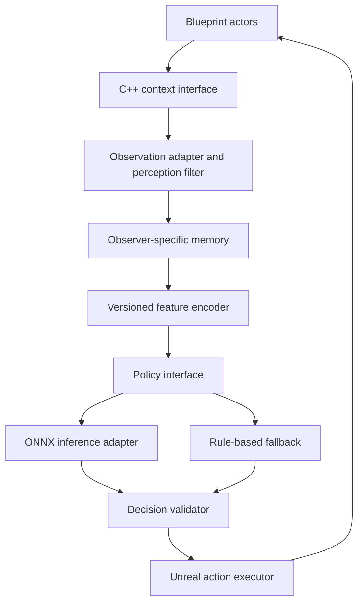

# Reflection-based C++ / Blueprint / AI context framework

Date: 2026-11-24 | Status: proposed design, pending review | Documentation only
Related issues: #3 (features), #6 (integration), #7 (perception and memory), #8 (social interaction). Governance: #1. No sprint implementation authorized.

## 1. Beginner's guide: why reflection?
Reflection lets software inspect metadata about its own types, properties and functions. RTTI identifies runtime types but does not enumerate arbitrary members. C++23 has no general native reflection; C++26 introduces compile-time static reflection, with compiler-dependent availability. Unreal uses its own runtime metadata generated by Unreal Header Tool (UHT). Do not depend on C++26 for this design.

| Macro | Purpose |
|---|---|
| UCLASS | Reflected UObject class |
| USTRUCT | Reflected value structure |
| UPROPERTY | Reflected property |
| UFUNCTION | Reflected function |
| UENUM | Reflected enumeration |
| UINTERFACE | Unreal interface declaration |
| GENERATED_BODY | Generated declarations |

Memory aid: reflection is a mirror; an interface is a contract; an adapter is a translator; a model is a decision adviser.

## 2. Architecture


Each layer has one responsibility. The Blueprint team owns presentation and actor behavior; the C++ team owns contracts, observation filtering, encoding, policy integration and validation. The Python team trains and exports a model against the same schema. No neural network directly reads arbitrary actor properties or invokes reflected functions.

## 3. Small hands-on example (future isolated test project)
Illustrative header fragment, not compiled; add appropriate includes, generated header last, module export macro and project-specific class name when implementing.

```cpp
UCLASS(Blueprintable)
class ARomanSoldier : public ACharacter
{
    GENERATED_BODY()
public:
    UPROPERTY(EditAnywhere, BlueprintReadOnly)
    int32 Rank = 3;

    UPROPERTY(EditAnywhere, BlueprintReadOnly)
    int32 Health = 100;

    UFUNCTION(BlueprintCallable)
    void Patrol();
};
```

1. During an approved integration sprint, create an isolated C++ character and implement Patrol in its .cpp file.
2. Compile with Unreal Build Tool; UHT generates metadata.
3. Create a Blueprint child and inspect Rank and Health in class defaults.
4. Add a second actor; change its rank and observe the permitted context snapshot in a diagnostic panel.
5. Hide that actor from the observer; confirm no fresh visual observation is generated.
6. Change its hidden health; confirm identical perceived inputs yield identical deterministic policy outputs.

Expected result: the editor exposes reflected properties, but the AI receives only approved observations. BlueprintReadOnly is not a confidentiality boundary; the adapter must enforce the boundary.

## 4. Contracts and design patterns
| Pattern | Proposed responsibility | Benefit |
|---|---|---|
| Interface / dependency inversion | IActorContextProvider and IDecisionPolicy contracts | Replace implementations independently |
| Adapter | Unreal observations to plain context; ONNX runtime to policy | Isolate engine/runtime dependencies |
| Facade | Blueprint-callable decision component | Small stable Blueprint API |
| Strategy | Rule-based versus neural policy | Swap and compare policies |
| Composition | Perception, memory and decision components | Avoid deep actor inheritance |

Names are proposals, not existing symbols. Prefer typed interface calls; use reflection for editor exposure, optional allowlisted metadata inspection and diagnostics, not unrestricted dynamic dispatch. Use BlueprintNativeEvent and generated Execute_ wrappers where Blueprint implementations of an Unreal interface must be supported. Keep UObject access on the game thread unless explicitly supported; copy plain snapshots before asynchronous inference. Use weak actor references or stable IDs, validate lifetimes and discard stale results.

## 5. Context and knowledge boundaries
Separate authoritative world state, observations and beliefs. Each observer has independent memory. A stable actor ID supports recognition but is not automatically a model feature. Social role, military rank, legal status, relationship and authority are distinct; do not reduce them to one universal numeric hierarchy. Historical roles and rules require review.

Example snapshot: observer sees a soldier with visible uniform, estimated rank, distance and confidence. Exact hidden health and private intentions are omitted. Unknown rank is represented by an explicit mask, not zero. Track source, timestamp, confidence and freshness per observation. A disguised actor may be misidentified; beliefs can be revised.

## 6. Model contract and execution
Define schema version, feature order, units, normalization, categorical vocabulary, unknown masks, tensor dtype/shape and action ordering before training. Fit preprocessing on training data only. Export ONNX with a supported opset; verify Python/ONNX numerical parity and target Unreal NNE runtime compatibility. Do not assume every operator is supported.

Policy returns action scores (e.g. Talk, Defend, Retreat, Ignore and other approved actions). Mask ineligible choices and independently validate the selected action against current authoritative game rules before execution. Invalid input, unavailable runtime, nonfinite scores, schema mismatch or expired result triggers deterministic safe fallback (e.g. Ignore). Never call arbitrary functions from model output. Persist versioned observer memory separately from model weights; encounters do not retrain the model.

## 7. TDD plan (not executed)
| Test first | Expected result |
|---|---|
| Missing context provider | Safe fallback, no crash |
| Unknown rank versus rank zero | Distinct encoded features |
| Hidden health changes alone | Identical perceived snapshot and deterministic inference |
| Unobserved actor | No new visual data |
| Two observers meet same actor | Independent beliefs and relationships |
| Role and rank change independently | Separate feature values |
| Wrong schema or tensor shape | Reject inference |
| Python versus ONNX fixture | Match within predeclared tolerance |
| Actor destroyed during inference | Discard result |
| Invalid action recommendation | Validator rejects it |
| Save/load memory | Supported beliefs restored; weights unchanged |

For each deterministic test: write test, observe RED, implement minimal GREEN, refactor, rerun regression. Use Python unit tests for encoder/model contracts, Unreal automation tests for C++ and Blueprint integration, and an isolated two-actor demo. For ML, use grouped train/validation/test splits, fixed seeds, baseline comparison, learning curves, macro F1 and per-action recall. Set acceptance thresholds before final test evaluation; synthetic imitation does not prove intelligence.

## 8. Sprint alignment and review
S02–S03 (#3): feature contract and baseline. S07–S08 (#6): ONNX adapter, facade and validation. S09–S10 (#7): perception and persistent memory. S11 (#8): social context. Existing dependencies, approval gates, Sunday rest and holiday pause remain unchanged. This guide does not add stories or authorize implementation.

Review checklist: confirm contracts and team ownership; approve knowledge boundaries; agree schema and fallback; verify runtime compatibility during integration; review actual tests and demos before accepting each sprint.

## 9. References
- [Unreal reflection overview](https://dev.epicgames.com/documentation/en-us/unreal-engine/reflection-system-in-unreal-engine)
- [Unreal interfaces](https://dev.epicgames.com/documentation/en-us/unreal-engine/interfaces-in-unreal-engine)
- [C++ static reflection proposal P2996](https://wg21.link/P2996)
- [ONNX](https://onnx.ai/)

Reference links supplied for further reading; not live-verified in this documentation task.

## 10. AI transparency
Drafted by ChatGPT (GPT-6.2) from the requested reflection framework discussion. Design choices are proposals. No executable code, model, tests, assets or sprint status changed. Product owner review of this document pending.
