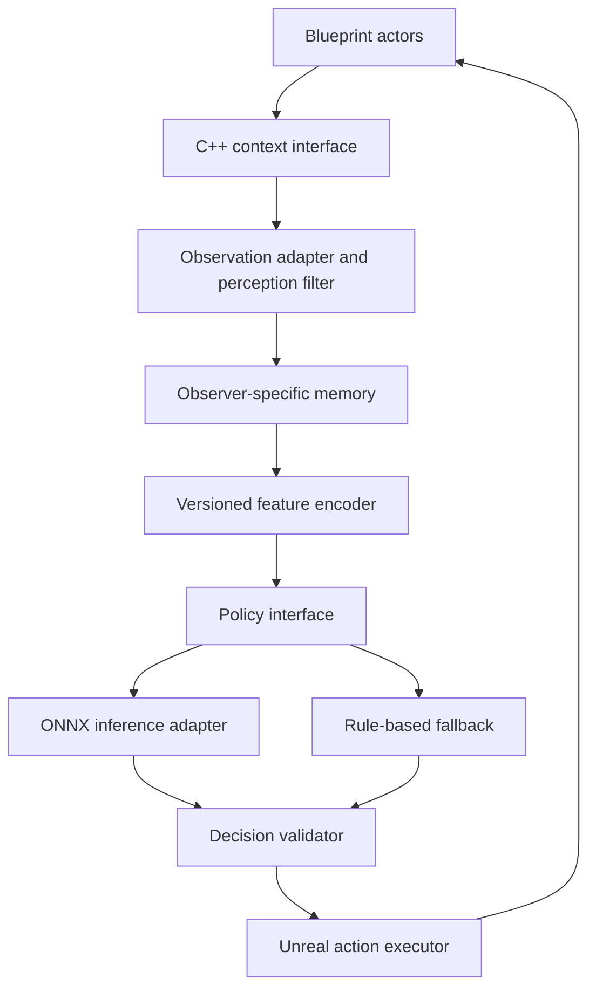
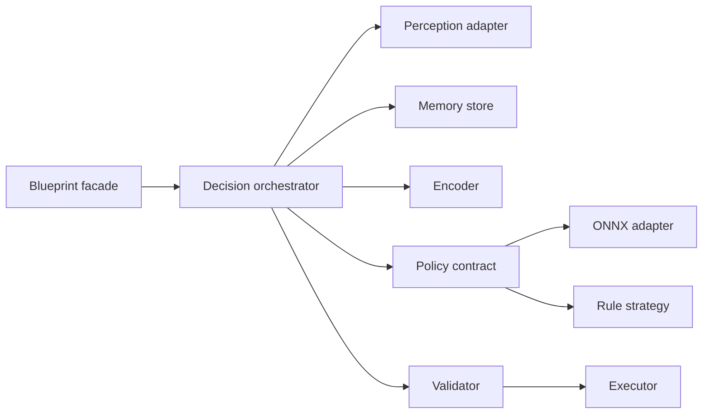

# Reflection-based C++ / Blueprint / AI context framework

Date: 2026-11-24 | Status: proposed design, pending review | Documentation only
Related issues: #3 (features), #6 (integration), #7 (perception and memory), #8 (social interaction). Governance: #1. No sprint implementation authorized.

## How to read this guide

**Everyone:** read the plain-English explanation and Roman example in each section. **Developers:** continue into the technical notes, contracts and tests. **Reviewers:** use the expected results to decide whether a future implementation meets the design. No programming experience is needed for the first reading.

### The problem in one minute

A gladiator meets a soldier. The gladiator should react differently to a friend, a stranger or an officer, but should not magically know their hidden health or intentions. Blueprint controls what happens on screen; C++ gathers and checks information; a neural network suggests what to do. Reflection helps the engine describe its objects, not read minds.

| Word | Everyday meaning | Technical meaning |
|---|---|---|
| Actor | Person or object in the scene | Unreal AActor instance |
| Class / instance | Building plan / actual building | Type definition / object |
| Property | Fact written on a card | Named member value |
| Metadata | Label describing the card | Type, name and flags describing a member |
| Interface | Contract | Stable callable API |
| Adapter | Translator | Converts one contract or representation to another |
| Facade | Reception desk | Simplified entry point |
| Policy | Decision adviser | Maps context to action scores |
| Validator | Referee | Enforces current rules |
| Tensor | Number-filled tray | Typed multidimensional array |
| Inference | Using learned knowledge | Forward pass of a trained model |
| Training | Studying examples | Optimizing model weights |

## 1. Beginner's guide: why reflection?
Reflection lets software inspect metadata about its own types, properties and functions. RTTI identifies runtime types but does not enumerate arbitrary members. C++23 has no general native reflection; C++26 introduces compile-time static reflection, with compiler-dependent availability. Unreal uses its own runtime metadata generated by Unreal Header Tool (UHT). Do not depend on C++26 for this design.

| Macro | Purpose |
|---|---|
| UCLASS | Reflected UObject class |
| USTRUCT | Reflected value structure |
| UPROPERTY | Reflected property |
| UFUNCTION | Reflected function |
| UENUM | Reflected enumeration |
| UINTERFACE | Unreal interface declaration |
| GENERATED_BODY | Generated declarations |

Memory aid: reflection is a mirror; an interface is a contract; an adapter is a translator; a model is a decision adviser.

### Technical deep dive: what reflection actually does

A normal C++ member is not automatically discoverable by name. RTTI (typeid and dynamic_cast, where enabled) answers limited type questions; templates and type traits answer compile-time questions. Unreal's UHT scans supported declarations before compilation, generates registration code, and the engine exposes metadata through UClass, UStruct, FProperty and UFunction. Not every C++ type is supported by UHT. Editor visibility, Blueprint access, serialization, replication and garbage collection are distinct concerns; each needs appropriate declarations and configuration.

Illustrative diagnostic fragment inside an Unreal .cpp file (requires UObject/UnrealType.h and a valid Actor on the game thread):

```cpp
if (IsValid(Actor))
{
    for (TFieldIterator<FProperty> It(Actor->GetClass()); It; ++It)
    {
        UE_LOG(LogTemp, Display, TEXT("%s"), *It->GetName());
    }
}
```

Expected: the output log lists reflected property names, including inherited ones according to iterator flags. It does not list every ordinary C++ member. This is a developer diagnostic only; never feed the entire list or values to a character's AI. Prefer typed accessors over name-based lookup in gameplay. Cache approved metadata only if profiling warrants it; invalidate caches when classes are reloaded.

## 2. Architecture


Each layer has one responsibility. The Blueprint team owns presentation and actor behavior; the C++ team owns contracts, observation filtering, encoding, policy integration and validation. The Python team trains and exports a model against the same schema. No neural network directly reads arbitrary actor properties or invokes reflected functions.

### Follow one encounter through the system

| Stage | Plain English | Technical output |
|---|---|---|
| Actor | Soldier enters view | Valid actor reference |
| Interface | Ask for observable facts | Typed provider response |
| Perception | Check what can be seen | Observer-specific observation |
| Memory | Recall previous meetings | Belief snapshot |
| Encoder | Translate facts into numbers | Versioned tensor |
| Policy | Suggest a response | Action scores |
| Validator | Check whether it is allowed now | Approved action or fallback |
| Executor | Make the character respond | Movement or dialogue intent |

A character may see a uniform, infer a rank, remember a previous conversation and choose to greet. If the target walks away before execution, the validator rejects the stale greeting. The model does not control animation directly.

### Proposed component boundaries



The orchestrator coordinates but does not implement every responsibility. Pure feature and policy contracts should avoid UObject dependencies where practical. Engine-specific adapters translate at the boundary. Inject fake providers and policies for tests. High cohesion means related work stays together; low coupling means replacing one component does not force unrelated changes.

## 3. Small hands-on example (future isolated test project)
Illustrative header fragment, not compiled; add appropriate includes, generated header last, module export macro and project-specific class name when implementing.

```cpp
UCLASS(Blueprintable)
class ARomanSoldier : public ACharacter
{
    GENERATED_BODY()
public:
    UPROPERTY(EditAnywhere, BlueprintReadOnly)
    int32 Rank = 3;

    UPROPERTY(EditAnywhere, BlueprintReadOnly)
    int32 Health = 100;

    UFUNCTION(BlueprintCallable)
    void Patrol();
};
```

1. During an approved integration sprint, create an isolated C++ character and implement Patrol in its .cpp file.
2. Compile with Unreal Build Tool; UHT generates metadata.
3. Create a Blueprint child and inspect Rank and Health in class defaults.
4. Add a second actor; change its rank and observe the permitted context snapshot in a diagnostic panel.
5. Hide that actor from the observer; confirm no fresh visual observation is generated.
6. Change its hidden health; confirm identical perceived inputs yield identical deterministic policy outputs.

Expected result: the editor exposes reflected properties, but the AI receives only approved observations. BlueprintReadOnly is not a confidentiality boundary; the adapter must enforce the boundary.

### What to look for in the editor

In a future approved exercise, use the Content Browser to locate the Blueprint child, open Class Defaults, and locate Rank and Health in Details. Use Window > Output Log (menu placement may vary by engine version) for diagnostic messages. Play in Editor with two actors and display a small observer debug panel. Compare the authoritative health against the observer's unknown-health mask. Do not edit the shared Colosseum map for this exercise.

## 4. Contracts and design patterns
| Pattern | Proposed responsibility | Benefit |
|---|---|---|
| Interface / dependency inversion | IActorContextProvider and IDecisionPolicy contracts | Replace implementations independently |
| Adapter | Unreal observations to plain context; ONNX runtime to policy | Isolate engine/runtime dependencies |
| Facade | Blueprint-callable decision component | Small stable Blueprint API |
| Strategy | Rule-based versus neural policy | Swap and compare policies |
| Composition | Perception, memory and decision components | Avoid deep actor inheritance |

Names are proposals, not existing symbols. Prefer typed interface calls; use reflection for editor exposure, optional allowlisted metadata inspection and diagnostics, not unrestricted dynamic dispatch. Use BlueprintNativeEvent and generated Execute_ wrappers where Blueprint implementations of an Unreal interface must be supported. Keep UObject access on the game thread unless explicitly supported; copy plain snapshots before asynchronous inference. Use weak actor references or stable IDs, validate lifetimes and discard stale results.

### Interface contract example

Illustrative engine-independent C++ pseudocode using standard library types; not a drop-in Unreal module:

```cpp
struct Observation {
    std::string targetId;
    std::optional<int> perceivedRank;
    float confidence;
    double observedAt;
};

class IObservationProvider {
public:
    virtual ~IObservationProvider() = default;
    virtual std::optional<Observation> Observe(
        const std::string& observerId,
        const std::string& targetId) const = 0;
};
```

The caller supplies the observer and target, not just the target. An empty optional means no observation, while an observation with empty perceivedRank means the target was observed but rank is unknown. Production Unreal-facing contracts may use FGuid, USTRUCT and explicit known flags for Blueprint compatibility; keep conversion in the adapter. The interface itself does not enforce visibility: its implementation must check perception and authorized sources. Use dependency injection to substitute a fake provider in tests.

When to use Blueprint: visual composition, animation, designer-tunable settings and presentation. When to use C++: stable contracts, lifecycle, validation, performance-sensitive processing and runtime integration. When to use Python: offline dataset generation, training, evaluation and export. Avoid duplicating authoritative rules across languages; use shared versioned specifications and golden fixtures.

## 5. Context and knowledge boundaries
Separate authoritative world state, observations and beliefs. Each observer has independent memory. A stable actor ID supports recognition but is not automatically a model feature. Social role, military rank, legal status, relationship and authority are distinct; do not reduce them to one universal numeric hierarchy. Historical roles and rules require review.

Example snapshot: observer sees a soldier with visible uniform, estimated rank, distance and confidence. Exact hidden health and private intentions are omitted. Unknown rank is represented by an explicit mask, not zero. Track source, timestamp, confidence and freshness per observation. A disguised actor may be misidentified; beliefs can be revised.

### Example: truth versus belief

| Fact | World truth | Observer A | Observer B |
|---|---|---|---|
| Identity | Soldier 42 | Recognized | Unknown |
| Rank | 3 | Estimated 3 | Unknown |
| Health | 70 | Unknown | Unknown |
| Relationship | Observer-specific | Familiar | Stranger |

These are fictional demonstration values, not historical claims. Store beliefs keyed by observer and target stable IDs. Update only from permitted observations; retain source and time. As evidence ages, confidence can decay according to a documented policy. Contradictory evidence may revise the belief. Save/load must validate versions and IDs; stale or missing targets must not crash the simulation.

## 6. Model contract and execution
Define schema version, feature order, units, normalization, categorical vocabulary, unknown masks, tensor dtype/shape and action ordering before training. Fit preprocessing on training data only. Export ONNX with a supported opset; verify Python/ONNX numerical parity and target Unreal NNE runtime compatibility. Do not assume every operator is supported.

Policy returns action scores (e.g. Talk, Defend, Retreat, Ignore and other approved actions). Mask ineligible choices and independently validate the selected action against current authoritative game rules before execution. Invalid input, unavailable runtime, nonfinite scores, schema mismatch or expired result triggers deterministic safe fallback (e.g. Ignore). Never call arbitrary functions from model output. Persist versioned observer memory separately from model weights; encounters do not retrain the model.

### A tiny numerical example

Suppose an approved schema has four features: visible flag, normalized distance, rank-known flag and normalized perceived rank. For demonstration only, distance 5 m with a 10 m scaling cap becomes 0.5; rank 3 with a maximum of 5 becomes 0.6. Input is [1, 0.5, 1, 0.6]. Unknown rank becomes [1, 0.5, 0, 0]. A known rank of zero has rank-known flag 1. The production vocabulary and scaling must be agreed and tested; Unreal defaults to centimeters, so convert explicitly to the chosen schema unit.

Example output scores for Talk, Defend, Retreat, Ignore: [2.1, 0.2, -0.4, 0.8]. These are illustrative logits, not probabilities. If Talk is disallowed, mask it and choose among remaining eligible actions, then revalidate before execution. If no action is eligible, perform an explicitly defined no-op. Define tie-breaking and nonfinite-value handling.

### Deployment and performance

Train offline in Python, export ONNX, load with a compatible runtime in Unreal, validate input/output names and shapes, and run parity fixtures. Keep model version, schema version and preprocessing version together. Load and reuse runtime resources rather than loading a model on every encounter. Schedule inference at a measured cadence, not automatically every frame; use request IDs and timestamps for asynchronous work, and reject expired responses. Profile latency and memory on target hardware before setting a budget. Model weights stay fixed during gameplay; memory changes independently. If model replacement fails compatibility checks, retain a validated model or use the rule-based fallback.

## 7. TDD plan (not executed)
| Test first | Expected result |
|---|---|
| Missing context provider | Safe fallback, no crash |
| Unknown rank versus rank zero | Distinct encoded features |
| Hidden health changes alone | Identical perceived snapshot and deterministic inference |
| Unobserved actor | No new visual data |
| Two observers meet same actor | Independent beliefs and relationships |
| Role and rank change independently | Separate feature values |
| Wrong schema or tensor shape | Reject inference |
| Python versus ONNX fixture | Match within predeclared tolerance |
| Actor destroyed during inference | Discard result |
| Invalid action recommendation | Validator rejects it |
| Save/load memory | Supported beliefs restored; weights unchanged |

For each deterministic test: write test, observe RED, implement minimal GREEN, refactor, rerun regression. Use Python unit tests for encoder/model contracts, Unreal automation tests for C++ and Blueprint integration, and an isolated two-actor demo. For ML, use grouped train/validation/test splits, fixed seeds, baseline comparison, learning curves, macro F1 and per-action recall. Set acceptance thresholds before final test evaluation; synthetic imitation does not prove intelligence.

### Learn TDD with one small test

RED means the test fails for the intended reason, GREEN means the minimal implementation passes, and REFACTOR means improving structure without changing behavior. For example, write a test that unknown rank and known rank zero encode differently. Initially a naive encoder that replaces both with zero fails. Add the known flag, rerun, then simplify the encoder and rerun all tests. Record actual evidence, not just a checked box.

Suggested test levels: pure encoder unit tests; fake-policy and fake-provider integration tests; Unreal automation tests for reflected interfaces and Blueprint dispatch; end-to-end two-actor demo; model evaluation on untouched held-out encounters. Overfitting means the model memorizes training examples but performs poorly on new encounters. Group related synthetic encounters into the same split to reduce leakage; compare training and validation curves and do not tune on the final test set.

### Troubleshooting guide

| Symptom | First check |
|---|---|
| Property missing in Details | UPROPERTY flags, successful UHT/build, Blueprint defaults |
| Blueprint cannot call function | UFUNCTION specifiers and supported types |
| Interface call fails | Interface implementation and Execute_ dispatch |
| AI knows hidden facts | Observation allowlist and memory provenance |
| ONNX model fails to load | Runtime, opset, operator and schema compatibility |
| Character acts on old information | Request timestamp and final validation |
| Good training but poor new encounters | Leakage, overfitting, split quality |

## 8. Sprint alignment and review
S02–S03 (#3): feature contract and baseline. S07–S08 (#6): ONNX adapter, facade and validation. S09–S10 (#7): perception and persistent memory. S11 (#8): social context. Existing dependencies, approval gates, Sunday rest and holiday pause remain unchanged. This guide does not add stories or authorize implementation.

Review checklist: confirm contracts and team ownership; approve knowledge boundaries; agree schema and fallback; verify runtime compatibility during integration; review actual tests and demos before accepting each sprint.

## 9. References
- [Unreal reflection overview](https://dev.epicgames.com/documentation/en-us/unreal-engine/reflection-system-in-unreal-engine)
- [Unreal interfaces](https://dev.epicgames.com/documentation/en-us/unreal-engine/interfaces-in-unreal-engine)
- [C++ static reflection proposal P2996](https://wg21.link/P2996)
- [ONNX](https://onnx.ai/)

Reference links supplied for further reading; not live-verified in this documentation task.

## 10. AI transparency
Drafted by ChatGPT (GPT-6.2) from the requested reflection framework discussion. Design choices are proposals. No executable code, model, tests, assets or sprint status changed. Product owner review of this document pending. Revised 2026-11-24 to provide dual-level explanations, diagnostic examples, explicit contracts, worked numerical examples and troubleshooting. Examples and tests remain illustrative and unexecuted.
