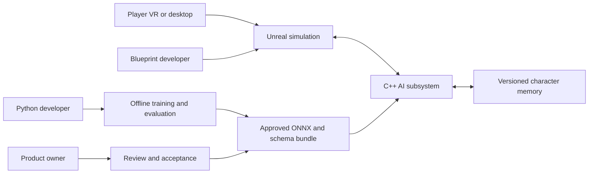
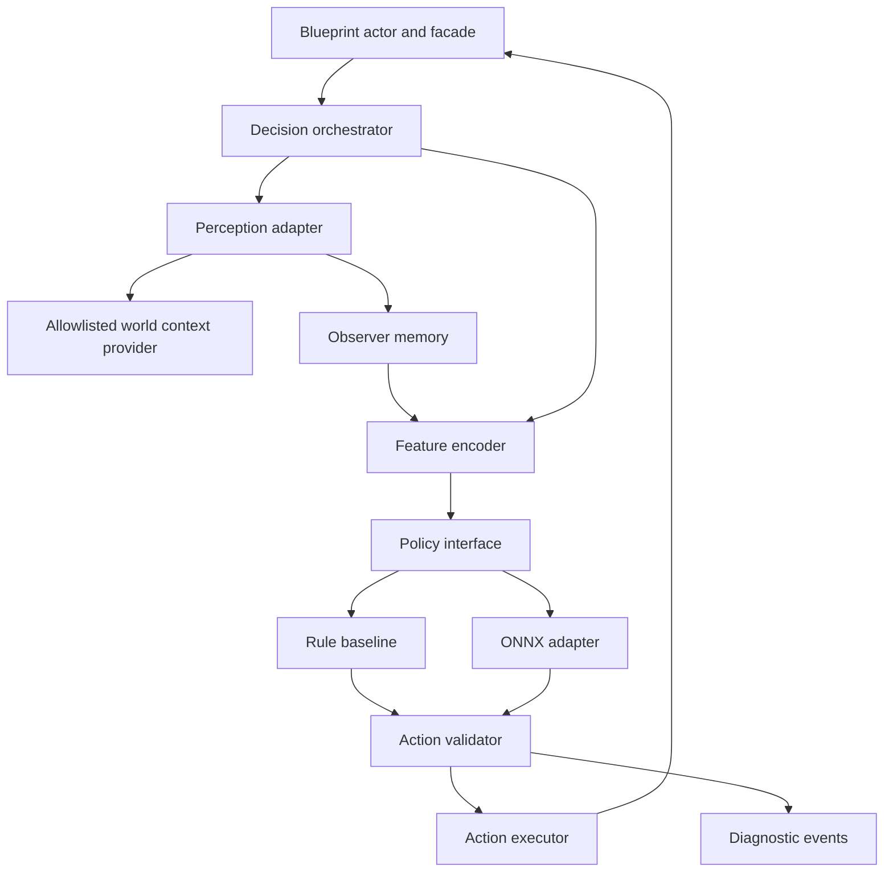
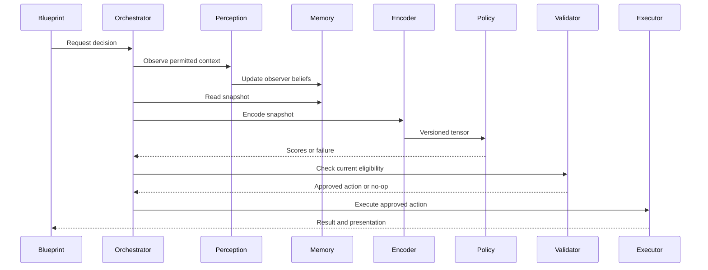

# ColosseumV3 — System architecture specification

Version 0.1 | 2026-11-24 | Proposed, pending product owner review
Scope: AI-model subsystem and its boundaries with the Unreal simulation. Governance #1; development #2–#9. This is documentation, not implementation approval.

## 1. Start here: the big picture

Imagine an actor in a Roman theatre. The stage is Unreal, the actor's senses are perception, a notebook is memory, an adviser is the AI policy, and a referee checks whether the proposed action is permitted. Blueprint makes the performance visible; C++ coordinates it; Python teaches the adviser offline. The adviser never gets unrestricted access to the stage.

Read the plain-English paragraphs first; technical tables and diagrams are for developers. For reflection mechanics and worked code examples see [reflection framework](REFLECTION_CONTEXT_FRAMEWORK.md). For the approved work sequence see [backlog](Planning/PRODUCT_BACKLOG.md). Return to [master index](MASTER_DOCUMENTATION_INDEX.md).

### Goals and boundaries

- Context-aware characters recognize other actors, perceived status, relationships and activity.
- Separate world truth from what each character can know; preserve memory across supported save/load.
- Use a deterministic baseline and replaceable neural policy with independently validated actions.
- Support independent Blueprint, C++ and Python work, testable contracts and VR/non-VR demonstrations.
- Preserve shared maps/assets and existing sprint approval gates.
- Non-goals: unrestricted generative dialogue, online retraining, perfect historical reconstruction, multiplayer/network architecture, or redesign of the entire Colosseum map. These require separate approval.

## 2. System context

The simulation runs without Python training processes or a remote AI service. The offline pipeline produces a reviewed artifact. Local inference is proposed; actual runtime and platform compatibility must be demonstrated. Historical claims need evidence and review; game mechanics are explicit assumptions.

## 3. Logical components and ownership

| Component | Plain English | Technical responsibility | Proposed owner |
|---|---|---|---|
| Actor/facade | Front desk | Reflected Blueprint API, presentation | Blueprint + C++ |
| Orchestrator | Coordinator | Request lifecycle, cancellation, sequencing | C++ |
| Context provider | Fact source | Typed allowlisted world data | C++ + Blueprint |
| Perception | Senses | Visibility, permitted sources, observations | C++ |
| Memory | Notebook | Observer-target beliefs and persistence | C++ |
| Encoder | Translator | Versioned numeric features, masks, scaling | Python + C++ |
| Policy | Adviser | Baseline or model scores | Python + C++ |
| Validator | Referee | Eligibility and authoritative rule checks | C++ |
| Executor | Performer | Approved action to engine behavior | C++ + Blueprint |
| Diagnostics | Flight recorder | Structured decision reasons and metrics | C++ + testers |

Ownership denotes proposed responsibilities, not assigned people. Keep pure domain contracts independent of engine objects where practical. Dependencies point toward contracts; concrete adapters are injected at composition time. Do not let policy import actor classes or executor call training code. Reflection exposes metadata; typed interfaces remain the normal gameplay path.

## 4. Runtime sequence and lifecycle

Example: a gladiator sees a familiar soldier, remembers a prior conversation and proposes Talk. If the soldier leaves range before execution, the validator rejects Talk and the system chooses an eligible fallback or no-op. An invisible soldier's hidden health must not alter the gladiator's perceived inputs.

Lifecycle: initialize dependencies and validate model bundle; register stable actor identity; collect observations at configured events/cadence; create immutable request snapshot; infer; validate current state; execute once; record outcome; cancel pending work on actor destruction, world teardown or incompatible model swap. Use game-thread UObject access unless explicitly supported; worker tasks operate on copied plain data and return via a safe game-thread handoff. Use request IDs, weak references, timestamps and generation/version tokens to discard stale responses. Avoid blocking the game thread on inference. Actual scheduling policy is TBD.

## 5. Data architecture and interface contracts

A contract is a shared form: every team agrees what each field means. The following are logical proposed records, not existing C++ classes or final tensor layouts.

| Record | Required conceptual fields | Invariants |
|---|---|---|
| Actor identity | stable ID, role/status descriptors | unique within supported world/save scope; not raw pointer |
| Observation | observer ID, target ID, source, time, known flags, values, confidence | permitted source; unknown distinct from zero |
| Belief snapshot | observer/target IDs, per-field estimate, age, confidence, relationship | independent per observer; no hidden truth leakage |
| Decision request | request ID, actor ID, snapshot, schema/model generation, deadline | immutable for inference |
| Feature tensor | schema version, ordered numeric values, masks, dtype, shape | finite and compatible; explicit units |
| Policy result | request ID, action scores, status, model version | finite scores; no arbitrary function names |
| Approved action | action enum, target ID if needed, validation reason | current eligibility; execute once |
| Save record | format version, world identity, belief records | validate and migrate or reject safely |

Proposed logical interfaces: Observe(observer,target), UpdateBeliefs(observation), Encode(snapshot), Evaluate(features), Validate(candidate,currentWorld), Execute(approvedAction). Return typed success/error results; distinguish no observation, unknown field, invalid input, unavailable policy and no eligible action. Concrete UINTERFACE/UFUNCTION signatures, ownership and async APIs are decided in approved sprints. Blueprint-facing structs use supported reflected types; engine-independent records can use standard C++ types. No arbitrary property lookup or unrestricted reflected invocation in the AI path.

### Worked example

Four illustrative inputs: visible=1, distance=5m scaled by 10m=0.5, rank-known=1, perceived rank=3 scaled by 5=0.6. Tensor [1,0.5,1,0.6]. Unknown rank becomes [1,0.5,0,0]. This is a teaching example, not a production schema. Unreal default length unit is centimeter; explicitly convert at the boundary. Agree final feature order, category encoding, units, normalization, missing masks, confidence, action order and schema compatibility in S02. Actor IDs are memory keys, not automatically model features.

Separate role, legal status, military rank, office, authority scope, personality and relationship. A senator does not automatically command every soldier. Historical interpretation must be reviewed before encoding rules.

## 6. Offline training and deployment architecture

Use deterministic seeds, dataset manifests, grouped splits and preprocessing fitted only on training data. Evaluate baseline versus MLP with macro F1, per-action recall, confusion matrix, learning curves and scenario tests. Synthetic labels imitate the generating policy; agreement alone does not establish superior intelligence or historical accuracy. Declare thresholds before final test; never tune on final test data. Export supported ONNX opset and verify input/output names, shapes, numerical parity and actual target NNE runtime operators.

Bundle proposal: ONNX model, schema, preprocessing metadata, action vocabulary, version manifest, checksums, evaluation/model card and parity fixtures. Load only approved compatible bundles. Model weights remain fixed during gameplay; memory persists independently. Rollback to previous compatible bundle or deterministic baseline; reject mismatched schema rather than guessing.

## 7. Physical deployment and repository boundaries

| Environment | Purpose |
|---|---|
| Developer Python environment | Pinned dependencies, dataset generation, training and tests |
| Unreal editor isolated practice map | Reflection, facade and two-actor integration |
| Packaged desktop simulation | Non-VR smoke and performance tests |
| Supported VR target | VR smoke, latency and input checks |

Proposed future module layout: domain/contracts, perception, memory, encoding, policy, validation, execution, Unreal adapters, diagnostics, Python training and tests. Exact source paths and module dependencies require inspection of actual project build files and team approval. This specification does not create folders or modify binary assets. Keep generated datasets and model binaries out of Git unless an approved artifact/LFS policy says otherwise. Use existing Git LFS coordination for shared Unreal assets.

## 8. Reliability, performance and observability

| Failure | Required response |
|---|---|
| Missing provider or invalid actor | No crash; safe no-op or validated fallback |
| Missing/invalid model or schema | Reject model; use baseline |
| NaN or malformed scores | Reject result; fallback |
| Target destroyed or request expired | Discard result |
| No eligible action | Explicit no-op |
| Corrupt/incompatible memory save | Report failure; preserve original; safe empty or supported migration |
| Execution failure | Report outcome; avoid infinite retry |

Record request ID, schema/model version, action, validation reason, fallback reason and latency in developer diagnostics. Avoid dumping private/hidden world data into player-visible logs. Measure inference latency percentiles, frame time, memory and active actor counts on agreed hardware. Batch or stagger decisions only after profiling; no invented performance targets. Cap queues and memory growth with approved limits. Save atomically where supported, validate loaded records, and test migration/rollback. Network replication and multiplayer authority are outside current scope.

## 9. Test architecture and acceptance

TDD means write a test that fails for the intended reason, make it pass, improve the code, rerun regression. Use fake providers/policies to test without a real model or full map.

| Level | Example evidence |
|---|---|
| Unit | Unknown rank differs from zero; deterministic ties; invalid ranges rejected |
| Contract | Python/C++ golden feature fixtures match; action vocabulary matches |
| Perception | Hidden health changes alone do not change perceived deterministic inference |
| Memory | Two observers retain independent beliefs; stale evidence decays; save/load |
| Integration | Blueprint interface dispatch, ONNX parity, missing model fallback |
| Lifecycle | Destroy actor during inference; stale request rejected; no duplicate execution |
| End-to-end | Two actors, visible diagnostics, approved action and memory update |
| ML | Grouped split leakage checks, held-out metrics, overfitting analysis |
| Release | Desktop/VR smoke, measured performance, rollback and review |

No tests have been executed for this document. Define actual thresholds and fixtures during approved work; follow [definition of done](Planning/DEFINITION_OF_DONE.md).

## 10. Design decisions and alternatives

| Proposed choice | Alternative | Trade-off |
|---|---|---|
| Typed interfaces plus Unreal reflection | Direct class dependencies or unrestricted reflection | More contracts, less coupling and accidental exposure |
| ONNX local inference | Embedded Python or remote service | Portable artifact, runtime/operator compatibility burden |
| Hybrid baseline and neural policy | Neural-only | More validation work, safer deterministic fallback |
| Observer memory separate from weights | Online retraining | Explicit memory lifecycle, predictable model |
| Immutable snapshots and async inference | Read live actors on worker | Copy overhead, clearer lifetime/thread safety |
| Versioned schema and golden fixtures | Implicit feature ordering | More maintenance, prevents silent mismatch |

These are proposed choices, not accepted ADRs. Revisit when measured evidence or requirements change.

## 11. Sprint traceability and review gates

S01 #2: environment, contracts and TDD foundation. S02–S03 #3: feature/perception/memory contracts and baseline rules. S04 #4: synthetic data. S05–S06 #5: training/evaluation. S07–S08 #6: ONNX, facade, validation and isolated demo. S09–S10 #7: perception and persistent memory implementation. S11 #8: multi-actor/social behavior. S12 #9: system validation and release.

Define perception/memory contract before generating training data; full implementation stays in existing later sprints. This is a proposed refinement within existing scope, not a schedule change. Explicit approval required before each sprint and issue closure. Sundays and holiday pause preserved.

Open decisions: exact engine/runtime compatibility, module paths, feature vocabulary, historical evidence, observation sources, confidence decay, persistence limits, action eligibility, hardware targets, performance budgets, artifact distribution and rollback policy. Assign owners and resolve in relevant approved sprints.

Review checklist: confirm scope and team boundaries; review data/knowledge separation; agree interfaces and schema timing; review failure behavior and test evidence requirements; approve or request changes. No acceptance implied by synchronization.

AI contribution: ChatGPT GPT-6.2 drafted this specification from existing reflection guide and approved planning. No executable code, assets, model or sprint status changed. Diagrams and interfaces are proposed; not compiled or runtime verified.
