# Unreal Engine 5.8 beginner's hands-on guide
## Illustrated foundations for Albert's Colosseum project

Author: Albert Leung's learning notes  
Prepared: October 30, 2026  
Target: Unreal Engine 5.8  
Status: Learning reference on `albert`; not a mandatory team implementation.

> Official version reference: [Epic's Unreal Engine 5.8 documentation](https://dev.epicgames.com/documentation/unreal-engine/unreal-engine-5-8-documentation). This landing page was verified in this conversation. Detailed documentation retrieval is currently unavailable, so this revision does not claim every menu, template, or plugin has been checked against 5.8. The exercises use standard UE5 workflows and have not been run in your project. Confirm your installed version in **Help → About Unreal Editor**, or its equivalent About screen.

## How to use this guide

Work through **one lesson at a time**. Each lesson has a visible finish line. Stop after reaching it, save, and return later. You do not need to understand the entire engine before moving one cube.

Use a separate practice project. Do not experiment in the team's active Colosseum map. A Git branch alone is not a separate project folder and does not isolate unsaved files.

Suggested sessions:

| Session | Lessons | Visible result |
|---|---|---|
| 1 | 1–4 | A saved map with a small arena floor |
| 2 | 5–7 | A reusable pillar and a button-triggered trapdoor |
| 3 | 8–10 | Understanding movement, collisions, and map organization |
| 4 | 11–13 | A repeatable troubleshooting and Git routine |

## Start here: your first 15 minutes

Do only these five tasks before reading everything else:

1. Open the separate `Colosseum_Learning` project described in lesson 2.
2. Press Play, click inside the viewport, and verify that the template character moves.
3. Stop Play and select one visible object.
4. Change its Location Z by 100 units and watch it move upward.
5. Save, then write one sentence: “I moved an Actor upward by one meter.”

**Finish line:** one visible change you understand and can repeat.

## Diagram key

The diagrams explain relationships and behavior; they are not screenshots of the 5.8 Editor. Boxes in Blueprint diagrams summarize nodes or operations. Search for the named nodes in the actual graph and check their pin types.

| Visual idea | Read it as |
|---|---|
| A box connected to another box | A relationship or an operation leading to another |
| A diamond | A question or decision |
| A labeled arrow | The stated relationship, value, or execution path |
| Parent above child | Ownership, attachment, or dependency as labeled |

GitHub renders these Mermaid diagrams. If your local Markdown viewer shows code instead, open the guide on GitHub. A blank preview is a viewer issue, not an Unreal problem.

## 1. Understand the pieces before clicking

Think of a project as the whole production, a level as one stage, and an Actor as something placed on that stage.

| Term | Plain-language meaning | Colosseum example |
|---|---|---|
| Project | Settings, code, assets, and maps belonging together | The whole Colosseum application |
| Level / map | A world you can open and populate | An arena practice area |
| Actor | An object that can be placed in a level | Pillar, door, light, camera |
| Component | A piece giving an Actor appearance or behavior | Mesh, collision box, audio |
| Static Mesh | Reusable geometry | A stone column shape |
| Material | Surface appearance | Rough limestone |
| Blueprint Class | A reusable class assembled visually | A trapdoor with a frame and moving panel |
| Instance | One placed copy of a class | Trapdoor number 3 |
| Pawn | An Actor that can be possessed and controlled | A free-flying spectator |
| Character | A Pawn specialized for character movement | A walking visitor |
| Player Controller | Represents a player's control of a Pawn | Routes the visitor's input |
| GameMode | Rules used by the running game | Which Pawn should spawn |
| Content Browser / Drawer | Where project assets are organized | Shelves holding meshes and Blueprints |
| Outliner | Actors in the currently open world | Objects currently on the stage |
| Details | Properties of your selected object | Position, mesh, material, collision |

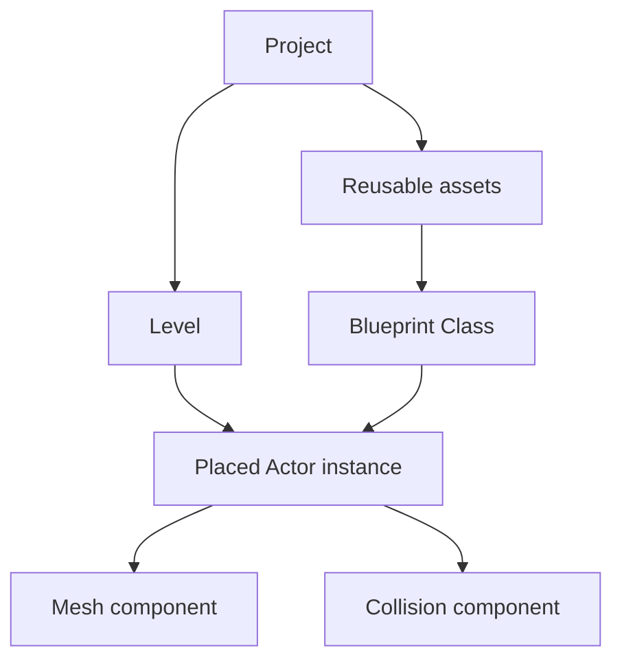

**Important distinction:** an asset in the Content Browser is not necessarily placed in the level. Deleting a placed instance is different from deleting its reusable asset.

**Checkpoint:** explain aloud: “The Blueprint is the reusable recipe. The Actor in my map is one copy.”

## 2. Create a safe learning project

### Goal

Open an independent project where mistakes are cheap.

1. Open your Unreal Engine installation.
2. Open the project creation screen.
3. Choose a simple **Games → Third Person** template if available in your installation.
4. Choose **Blueprint** for this introductory project.
5. Name it `Colosseum_Learning`.
6. Pick a local project folder separate from the team's existing project folder.
7. Create and open it.
8. Wait for initial compilation or asset preparation to finish.
9. Save the project.

Template names and options can vary. Use an equivalent simple playable template if Third Person is unavailable.

Why Blueprint first? These lessons teach the Editor, assets, and events without requiring a working C++ toolchain. Visual Studio or Rider integration can be learned separately.

### Checkpoint

Press **Play**. A playable template should let you control its example character. Click inside the viewport to give it keyboard focus. Press **Esc** to stop.

If you cannot control anything, complete the template's own input setup before changing your team's project.

### Record your baseline

Write down:

- Engine version.
- Template chosen.
- Operating system.
- Whether Play works before edits.

A working baseline is your “it worked before I touched it” receipt.

## 3. Learn the Editor's main areas

The default arrangement can be customized. Locate these areas by name:

| Area | What to do there | Quick experiment |
|---|---|---|
| Viewport | Look around the world and select objects | Click the floor |
| Outliner | Find placed Actors | Select the same floor by name |
| Details | Change the selected Actor | Find Transform |
| Content Browser / Drawer | Find or create assets | Find the Content folder |
| Toolbar | Save and run | Locate Play and Stop |

### Camera navigation

In a perspective viewport, common UE5 controls include:

- Hold right mouse button and use W/A/S/D to move the editor camera.
- While holding right mouse button, Q/E commonly move down/up.
- Mouse movement while holding right mouse button changes viewing direction.
- Select an object and press **F** to focus it.
- W selects move, E rotation, R scale when you are not using them as camera movement controls.

These are **Editor camera controls**. They do not automatically create game input.

### Tiny exercise

1. Select a visible object.
2. Press F.
3. Orbit or move around it.
4. Select another object in the Outliner.
5. Find its Location, Rotation, and Scale in Details.

**Checkpoint:** select an object in either the Viewport or Outliner and see the same object's properties.

## 4. Make an arena practice map

### Create folders

Inside project Content, create:

```text
Learning/
  Maps/
  Blueprints/
  Materials/
```

Create and save a new basic level as `L_Arena_Practice` under `Learning/Maps`. If your new-level dialog offers a basic lit level, use it. Otherwise start from an equivalent simple level with lighting.

### Place a floor

1. Find the Editor's **Place Actors / Shapes** controls.
2. Add a **Cube**.
3. Rename the placed Actor `Arena_Floor`.
4. Set Location to X=0, Y=0, Z=-50.
5. Set Scale to X=20, Y=15, Z=1.
6. Leave Rotation at zero.
7. Save the map.

For the standard 100-unit cube, these settings make an approximately 20 m × 15 m × 1 m floor with its top at Z=0. Verify the cube's actual dimensions if using a different asset.

### Understand coordinates

Standard Unreal world axes:

| Axis | Direction convention | Example |
|---|---|---|
| X | Forward | Along the arena |
| Y | Right | Across the arena |
| Z | Up | Toward the roof |

Standard Unreal distance units are centimeters: 100 units = 1 meter.

Scale is a multiplier, not a distance. Scale 2 means twice the mesh's original size.

### Place the player start

1. Add or locate a **Player Start** Actor.
2. Put it above the floor, for example X=0, Y=0, Z=120.
3. Make sure it does not overlap the floor or another object.
4. Save and press Play.

A newly created map may need the template's GameMode configured in World Settings. Use the existing template GameMode; do not replace it with an empty one casually.

**Checkpoint:** the character appears above the floor and can stand on it.

### World and relative transforms: the difference that makes hinges work

A Transform contains Location, Rotation, and Scale.

- **World transform:** where something is in the level.
- **Relative transform:** where a component is relative to its parent.
- **Attachment:** moving or rotating the parent also affects attached children.

Example: the trapdoor Actor can be placed anywhere in the arena. Hinge is attached to its root, and DoorPanel is offset from Hinge. You rotate Hinge locally to open the door, without needing to calculate a new world position for every corner.

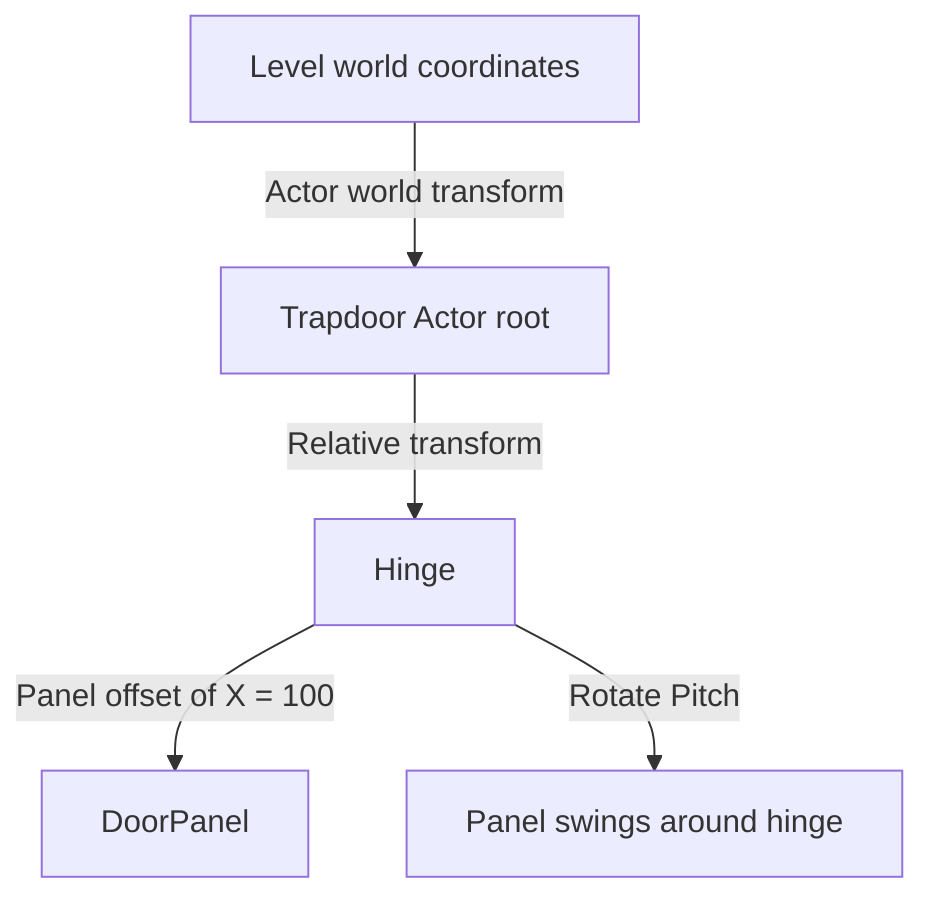

**Hands-on check:** move the whole trapdoor Actor 500 units along X. Then press T in Play. It should still open around its own hinge.

## 5. Create a reusable pillar Blueprint

### Goal

Build one recipe and place several copies.

1. In `Learning/Blueprints`, create a **Blueprint Class**.
2. Choose **Actor** as its parent.
3. Name it `BP_PracticePillar`.
4. Open it.
5. In Components, add a **Static Mesh** component.
6. Name the component `PillarMesh`.
7. Assign the engine's basic **Cylinder** mesh, if available.
8. Leave the default scene root for this exercise.
9. Set the mesh's relative Location to Z=200.
10. Set its relative Scale to X=1, Y=1, Z=4.
11. Compile and save.
12. Drag the Blueprint asset into the map.
13. Place the Actor at Z=0.

With a centered 100-unit-tall cylinder, the panel settings make the pillar 400 units tall, positioned with its bottom at the Actor's origin. Verify dimensions for the mesh used.

Place three copies and give them different world locations.

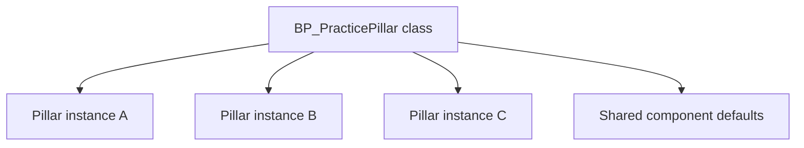

### Test class versus instance

1. Change the mesh's default appearance or scale in the Blueprint.
2. Compile and save.
3. Check the placed instances.
4. Then change only one placed Actor's overall scale.

Class-default changes generally propagate to instances unless the corresponding property has been overridden. An instance's transform can differ from the class default.

**Checkpoint:** you can tell the difference between changing the recipe and changing one placed copy.

## 6. Give an object a material

1. In `Learning/Materials`, create a Material named `M_PracticeStone`.
2. Open the material.
3. Add a **Constant3Vector** node by searching for it in the graph.
4. Choose a gray or sandy color.
5. Connect it to **Base Color** on the material output.
6. Add a scalar Constant, set it to 0.8, and connect it to **Roughness**.
7. Leave Metallic at its default zero for this simple stone example.
8. Apply and save.
9. Open `BP_PracticePillar`.
10. Select `PillarMesh` and assign the material to its material slot.
11. Compile and save.

**Checkpoint:** your pillars change appearance in the level.

A material changes surface shading; it does not add stone geometry or collision. A gray cube is still a cube, however persuasive its résumé.

## 7. Build a trapdoor that visibly opens

This is a learning model, not a historically accurate finished asset.

### A. Build its parts

1. Create an Actor Blueprint named `BP_PracticeTrapdoor`.
2. Keep its DefaultSceneRoot.
3. Add a **Scene Component** named `Hinge`, attached to the root.
4. Add a **Static Mesh** component named `DoorPanel`, attached to Hinge.
5. Assign a standard Cube mesh.
6. Set DoorPanel relative Scale to X=2, Y=2, Z=0.1.
7. Set DoorPanel relative Location to X=100, Y=0, Z=0.
8. Set DoorPanel mobility to **Movable**.
9. Leave Hinge at relative Location 0,0,0.
10. Compile and save.

For a 100-unit centered cube, the panel is 200 units long and its edge now meets the Hinge's origin. Rotating Hinge rotates the panel around that edge.

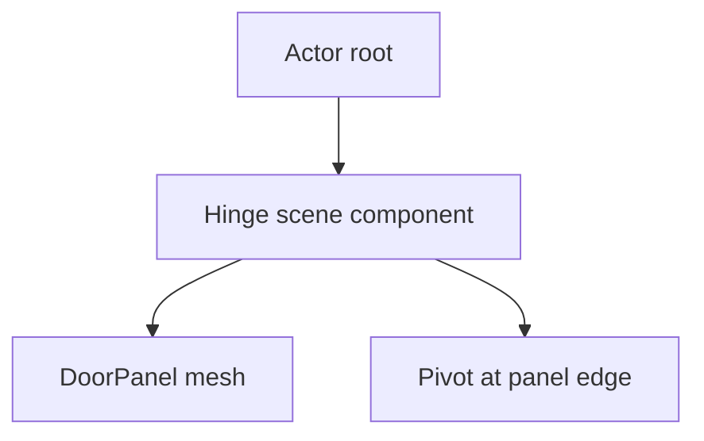

### B. Make the Actor receive a practice key

For this standalone exercise only:

1. In the Blueprint's Class Defaults, find **Auto Receive Input**.
2. Set it to **Player 0**.
3. In the Event Graph, add a **T keyboard event**.
4. Add a **FlipFlop** node.
5. Connect T's Pressed execution pin to FlipFlop.

This deliberately simple method lets a placed Actor react to a key. Production input usually belongs in a Pawn or Player Controller. If you place many input-enabled trapdoors, they may respond together or consume input unpredictably. Keep just one for this lesson.

### C. Rotate the hinge

1. Drag Hinge from Components into the graph as a reference.
2. From it, create **Set Relative Rotation**.
3. Connect FlipFlop A to this node.
4. Set its rotation to Pitch=-90, Yaw=0, Roll=0.
5. Add a second Set Relative Rotation targeting the same Hinge.
6. Connect FlipFlop B to the second node.
7. Set its rotation to Pitch=0, Yaw=0, Roll=0.
8. Compile and save.

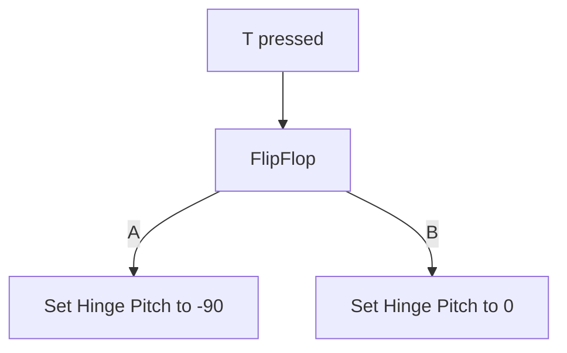

Pitch rotates around the Y axis. If the panel opens in the wrong direction for your layout, inspect the component orientation and try +90 instead of -90.

### Read the graph before connecting wires

Blueprint graphs have execution flow and data flow.

| Pin or connection | Job | Example |
|---|---|---|
| Execution pin | Determines when an operation runs | T Pressed → FlipFlop |
| Target object | Identifies the object to modify | Hinge component reference |
| Rotation value | Provides the requested orientation | Pitch=-90 |
| Boolean | A true/false value | Is the door open? |

Do not identify data types by color alone. Read the pin label and tooltip.

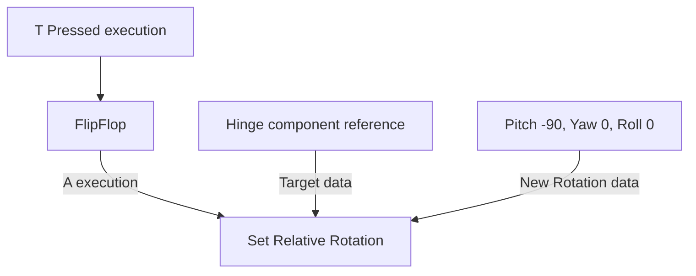

**Hands-on check:** if execution arrives but Target points at the wrong component, the intended panel may not move. Check both the execution wire and Target.

### Trapdoor pivot checklist

| Part | Relative position | Purpose |
|---|---|---|
| Hinge | X=0, Y=0, Z=0 under Actor root | Defines the rotation center |
| DoorPanel | X=100, Y=0, Z=0 under Hinge | Offsets a centered 200-unit panel so one edge meets the hinge |
| DoorPanel scale | X=2, Y=2, Z=0.1 for the standard cube | Makes the panel approximately 200 × 200 × 10 units |

These dimensions assume the standard centered 100-unit cube. Scale the **mesh component**, leaving Hinge scale at 1,1,1 for the exercise.

**Common mistake:** moving Hinge and DoorPanel together in the same way leaves the panel centered on its pivot. Inspect the hierarchy and the panel's relative offset.

### D. Test above the floor

1. Place one trapdoor in the practice map.
2. Put it above the floor where you can see the panel clearly.
3. Press Play.
4. Click inside the viewport.
5. Press T, then press T again.

**Checkpoint:** the panel snaps between closed and open.

The solid arena floor still exists under it. Opening the panel will not create a hole in that floor.

### E. Make an actual opening later

To create a fall-through opening, build the surrounding floor from separate sections leaving a gap. Place the trapdoor across the gap and put a lower floor underneath for the prison area.

Check collision on the surrounding floor and panel. Do not disable all collision just to make the character fall.

### Optional next step: animate instead of snapping

Replace instantaneous switching with a Timeline driving a float from 0 to 1. Use Lerp (Rotator) between the closed and open rotations, and set Hinge's relative rotation on each Timeline Update. Use Play to open and Reverse to close. First get the snapping version working.

## 8. Understand Play, Simulate, and possession

| Mode | Useful for | Common misunderstanding |
|---|---|---|
| Editor viewport | Building the world | Editor WASDQE does not configure runtime movement |
| Play | Testing the running game and player input | A suitable Pawn still needs to spawn and be possessed |
| Simulate | Observing simulation behavior | It may begin without controlling a Pawn |

Toolbar wording and possession controls depend on your installed version and play configuration.

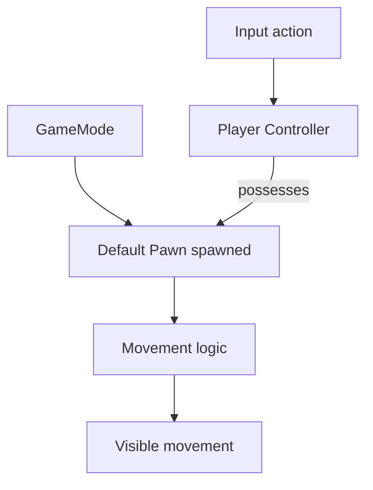

This is a conceptual flow. Enhanced Input bindings can be handled in the Pawn, Controller, or another appropriate owner.

### Why A/D can print but not move

A Print String only proves that execution reached that node. It does not prove movement was applied.

Check in this order:

1. Is the intended Pawn actually possessed?
2. Does it have a movement component appropriate to its type?
3. Does the input value reach the movement logic?
4. Is the movement direction nonzero and correct?
5. Is collision blocking movement?
6. Is another part of the graph immediately resetting location?

For a free-flying Pawn, a FloatingPawnMovement component is one possible approach. A Character normally uses CharacterMovement. Do not add a second movement system without understanding the first.

### Enhanced Input in plain language

| Item | Job |
|---|---|
| Input Action | Defines the kind of input, such as a 2D movement value |
| Input Mapping Context | Maps physical keys or controls to actions |
| Modifier | Adjusts the input value, such as negating or rearranging axes |
| Action event handler | Uses that value to perform behavior |

The mapping context must be active for the appropriate local player. Swizzle and Negate modifiers can make individual keys contribute to the intended X/Y/Z input axes. Their exact settings depend on your action's value type and graph, so copy the principle rather than blindly copying someone else's axis order.

### Trace input one checkpoint at a time

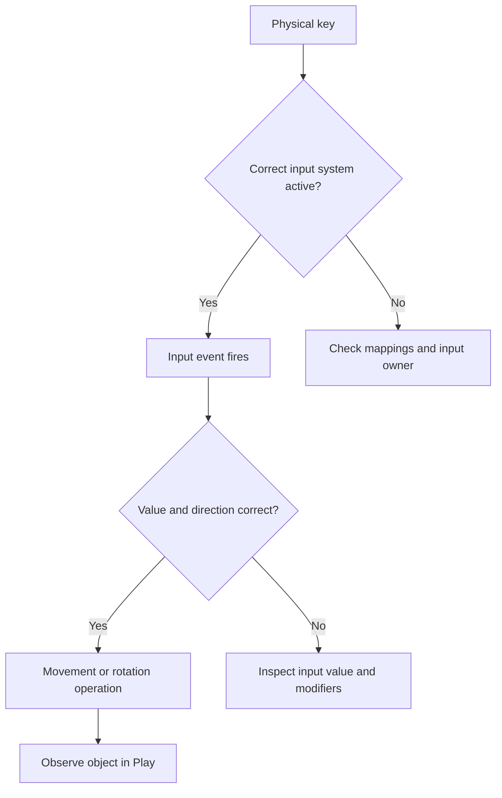

The T-key trapdoor lesson uses a simple Actor keyboard event. The template's player movement may use Enhanced Input. These are separate examples; changing a movement Mapping Context does not automatically repair the trapdoor's input ownership.

For production interaction, a useful later architecture is: the player handles the interaction key, identifies the targeted door, and calls an interaction event or interface on that door. Avoid making every door listen directly to the same keyboard event.

## 9. Organize a Colosseum without one giant Blueprint

Begin with a small layout:

| Element | Suggested responsibility |
|---|---|
| Arena map | Places the environment and gameplay Actors |
| Pillar Blueprint | Reusable pillar assembly |
| Trapdoor Blueprint | Panel, hinge, opening behavior |
| Prison-door Blueprint | Door-specific behavior |
| Player Pawn or Character | Player movement and interaction |
| Lighting Actors | Illumination |
| Shared materials | Consistent surfaces |

Avoid making the Level Blueprint responsible for every door and pillar. Reusable Actor classes are easier to test separately.

Separate Actors alone do **not** guarantee conflict-free Git collaboration. In conventional maps, multiple placed Actors may still be serialized into the same map file. World Partition and One File Per Actor can change storage behavior, but require deliberate project setup and team agreement.

Do not enable them casually in an established team project. First agree on engine version, map workflow, locking, and which files each person owns.

### A small Colosseum test slice

Build and verify a tiny vertical slice before copying it around the arena:

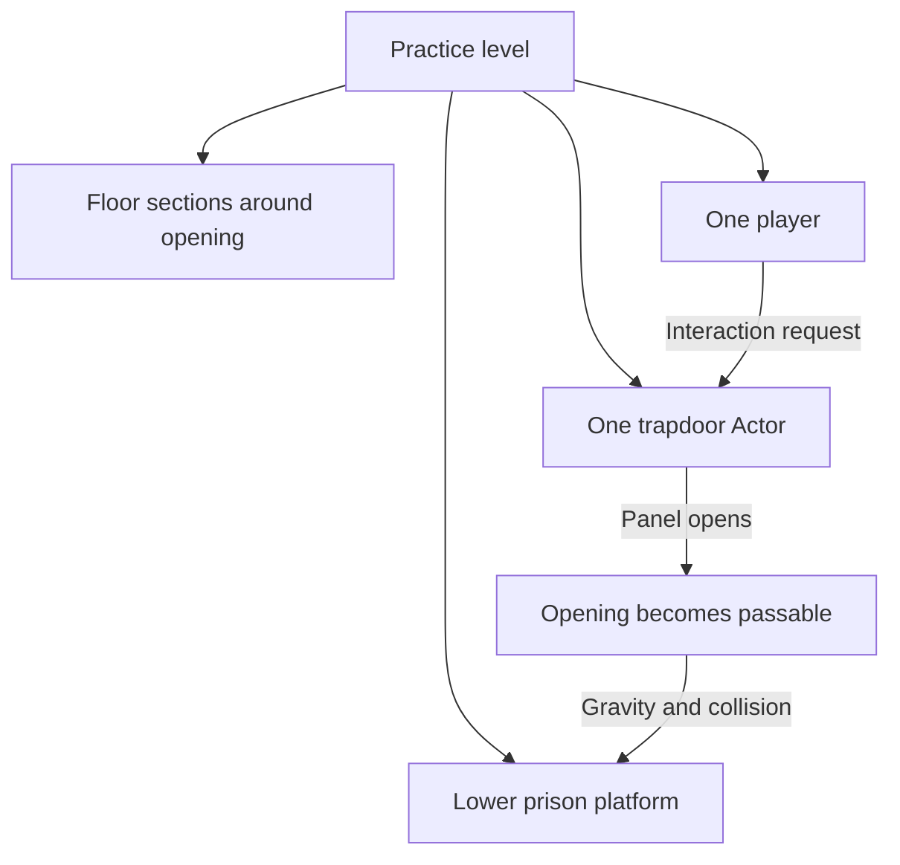

This diagram is the intended later behavior, not a claim that the introductory T-key example already provides player targeting or a finished prison.

**Build order:** surrounding floor → one trapdoor → lower platform → collision test → interaction → animation. Save after each successful checkpoint.

## 10. Collision and physics: two different jobs

**Collision** decides whether objects block, overlap, or ignore each other. **Physics simulation** lets a physics solver move objects.

A rotating trapdoor controlled by Blueprint does not automatically need Simulate Physics enabled.

### Quick collision test

1. Play your map.
2. Walk onto the floor.
3. Walk into a pillar.
4. Observe whether it blocks movement.
5. If it does not, inspect the mesh/component collision settings.
6. Check its collision preset and whether the mesh has appropriate collision geometry.

Use a blocking preset suitable for the object and the Pawn's collision response. Overlap events and blocking are different behaviors.

**Checkpoint:** the player stands on the floor, cannot walk through the pillar, and can observe the trapdoor opening.

## 11. Save correctly and understand what Git sees

| File or folder | Meaning |
|---|---|
| `.uproject` | Project descriptor |
| `Content/` | Unreal assets such as Blueprints and materials |
| `.uasset` | Asset package, usually binary |
| `.umap` | Level package |
| `Config/` | Project configuration |
| `Source/` | C++ source, when present |
| `Saved/`, `Intermediate/` | Generated working data; usually excluded from source control |
| `DerivedDataCache/` | Generated cache; usually excluded |

A Blueprint graph is generally stored inside a binary asset, not as an ordinary text file Git can merge line by line.

Save assets in Unreal before checking Git. Compiling a Blueprint and saving it are separate concerns.

### End-of-session routine

1. Stop Play.
2. Compile changed Blueprints.
3. Save the map and modified assets.
4. Review any errors.
5. Close the Editor before branch changes.
6. Run:

```bash
git status
git diff --stat
```

Stage intentional paths rather than every generated file. Follow the team's Git LFS and locking rules for binary assets. A repository without the actual required assets is not a reproducible example.

## 12. A debugging loop that does not become a three-hour spiral

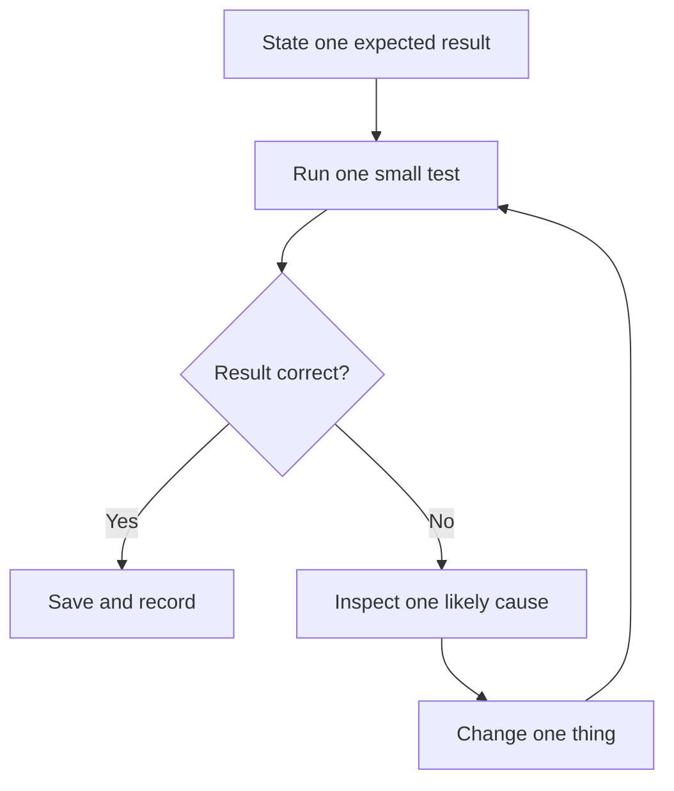

Example: “Pressing T rotates Hinge.” That is specific enough to test.

| Symptom | First checks |
|---|---|
| Nothing happens when pressing T | Play active, viewport focus, Auto Receive Input, correct placed Actor |
| Print appears but panel does not move | Target Hinge, execution connection, rotation values, mobility |
| Rotation occurs around panel center | Panel attached to Hinge, offset from Hinge |
| Player falls through floor | Collision, floor placement, Pawn collision |
| Player appears elsewhere | GameMode, Pawn spawning, Player Start |
| Object exists but cannot be found | Outliner selection, F to focus, visibility |
| Blueprint works in one map only | Map settings, instance overrides, dependencies |
| Team cannot open example | Engine version, plugins, missing assets or LFS content |

For each problem, record:

```text
Expected:
Observed:
Engine version:
Smallest steps that reproduce it:
One change tried:
Result:
```

## 13. Your next learning milestones

Complete these in order:

- [ ] Open a separate playable practice project.
- [ ] Identify Viewport, Outliner, Details, and Content Browser.
- [ ] Save L_Arena_Practice.
- [ ] Place a correctly sized floor and Player Start.
- [ ] Build BP_PracticePillar and place three instances.
- [ ] Apply M_PracticeStone.
- [ ] Open and close BP_PracticeTrapdoor with T.
- [ ] Explain why a solid floor prevents falling through the open panel.
- [ ] Explain Editor movement versus runtime player movement.
- [ ] Save and record one successful test.

Only then expand toward a small prison room, animated trapdoor, interaction prompt, and team-approved C++/Blueprint boundary. A tiny working scene teaches more than an enormous broken replica.

## Where do I find it? Location guide and memory aids

Use this section while the Editor is open. The locations below describe common UE5 layouts, not a verified screenshot-by-screenshot map of 5.8. Panels can be moved or hidden. Use the **Window** menu to look for a missing panel; exact menu labels can vary.

### Remember five places first

Say aloud: **“Look, List, Details, Library, Logic.”**

| Memory word | Unreal name | What you use it for | Typical place |
|---|---|---|---|
| Look | Viewport | See and select the world | Large central area |
| List | Outliner | Find objects already placed in the world | Often upper right |
| Details | Details panel | Change properties of the selected object | Often lower right |
| Library | Content Browser / Content Drawer | Find saved assets and reusable recipes | Often bottom; Drawer can slide open |
| Logic | Blueprint Event Graph | Connect behavior | Inside a Blueprint Editor window |

**Memory sentence:** “Look at the world, find it in the List, change its Details, get recipes from the Library, give them Logic.”

These positions describe a common layout. Names are more reliable than screen positions.

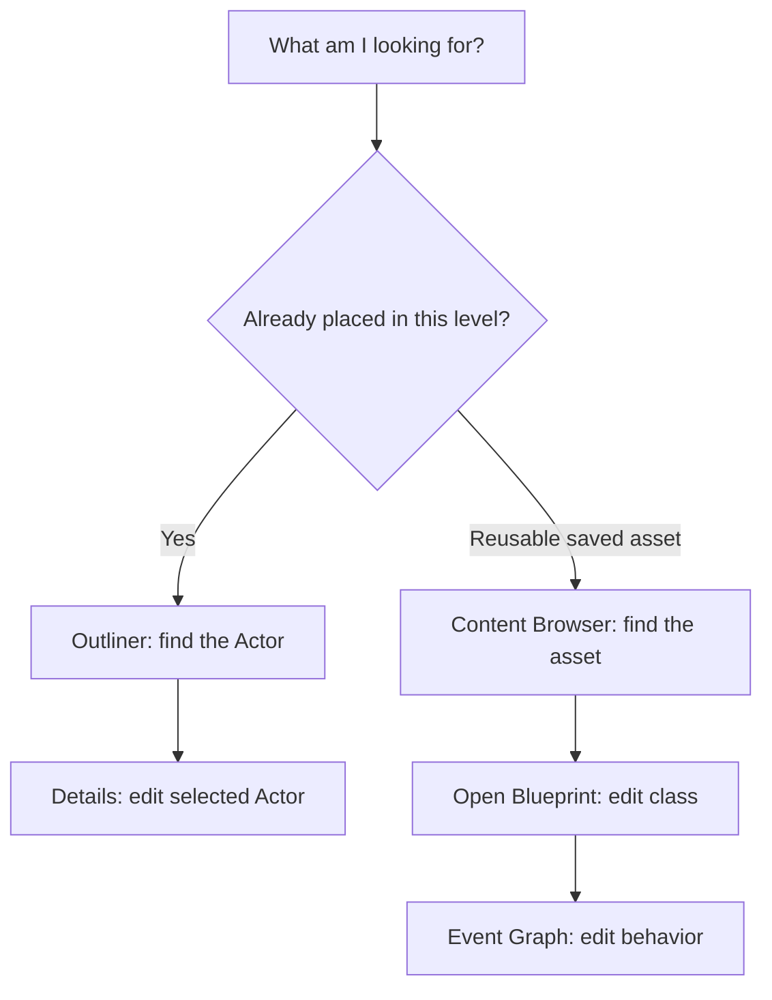

### Find things by the task you want to do

| I want to… | Where to start | What to select or search for | Memory aid |
|---|---|---|---|
| Find a pillar already in my arena | Outliner | Search its Actor name | **On stage → Outliner** |
| Find the reusable pillar Blueprint | Content Browser / Drawer | Search BP_PracticePillar | **Recipe → Content** |
| Move one placed pillar | Select it → Details → Transform | Location | **Where → Location** |
| Turn one placed pillar | Details → Transform | Rotation | **Face → Rotation** |
| Resize one placed pillar | Details → Transform | Scale | **Size multiplier → Scale** |
| Find a selected object in the viewport | Viewport | Press F with viewport focus | **F = Focus** |
| Add a basic cube or cylinder | Place Actors / Shapes | Cube or Cylinder | **Place a shape** |
| Create a reusable Blueprint | Content Browser context menu | Blueprint Class → Actor | **Create recipe in Content** |
| Add a mesh or hinge to a Blueprint | Open Blueprint → Components | Add component; Static Mesh or Scene | **Parts → Components** |
| Choose which mesh a component displays | Select mesh component → Details | Static Mesh asset field | **Shape → Mesh** |
| Choose surface appearance | Mesh component → Details | Materials slots | **Skin → Material** |
| Find the Hinge's child panel | Blueprint → Components hierarchy | Expand Hinge | **Parent holds child** |
| Make a panel move at runtime | Select mesh component → Details | Mobility → Movable | **Moving part → Movable** |
| Add T-key behavior | Blueprint → Event Graph | Right-click empty graph; search T keyboard event | **Behavior → Graph** |
| Rotate the correct hinge | Graph; drag Hinge reference from Components | Set Relative Rotation | **Reference first, operation second** |
| Check collisions | Select relevant component → Details | Search Collision | **Blocking → Collision** |
| Set the practice Actor's keyboard input | Blueprint → Class Defaults | Search Auto Receive Input | **Who listens? → Input** |
| Choose default Pawn for a map | World Settings | GameMode override and its defaults | **Rules choose player setup** |
| Find an Input Action or Mapping Context | Content Browser search | Asset name or asset-type filter | **Input definitions are assets** |
| See whether a Mapping Context is activated | Relevant Pawn/Controller setup graph or code | Add Mapping Context or project-specific setup | **Asset exists does not mean active** |
| Open a saved map | Content Browser | Find the map asset and open it | **World recipe → Map asset** |
| Run the scene | Main toolbar | Play | **Test → Play** |
| Stop the scene | Play controls / focused play viewport | Stop or Esc | **Stop before editing workflow** |
| Check warnings and errors | Window menu and relevant log panels | Output Log or Message Log | **Evidence → Logs** |
| See Blueprint compilation problems | Blueprint Editor | Compile results / Compiler Results | **Graph errors → Compiler Results** |
| Change project-wide options | Settings / Edit menus, depending on layout | Project Settings | **Whole project → Project Settings** |
| Change your Editor preferences | Edit or settings menus | Editor Preferences | **My workspace → Preferences** |
| Enable a plugin | Settings / Edit menus | Plugins | **Extra capability → Plugin** |

Search within Details can make properties appear missing. Clear the search box when you finish. Also confirm whether you selected the placed Actor, Blueprint class defaults, or an individual component: their Details panels expose different properties.

### Three windows that beginners often mix up

| Workspace | You are editing… | Example change |
|---|---|---|
| Level Editor | A world and its placed instances | Move one trapdoor to the prison entrance |
| Blueprint Editor | A reusable class and its components/graphs | Change the hinge behavior for the trapdoor class |
| Material Editor | A surface shading asset | Change stone color and roughness |

**Memory aid:** **“Level places. Blueprint behaves. Material dresses.”**

If you are looking for Event Graph inside the Material Editor, you are in the wrong workspace. First check the asset name and tab title.

### Blueprint tabs: which one do I need?

| Item | Purpose | Memory question |
|---|---|---|
| Components | Parts and attachment hierarchy | “What is it made of?” |
| Viewport | Visual arrangement of components | “How do the parts fit?” |
| Event Graph | Event-driven behavior | “What happens?” |
| My Blueprint | Variables, functions, graphs, and related items | “What have I defined?” |
| Class Defaults | Default property values for the class | “What should new copies start with?” |
| Details | Properties of the selected component, node, or other item | “What have I selected?” |
| Compile | Process/check graph changes | “Can this run?” |
| Save | Preserve asset changes on disk | “Will this still be here later?” |

### Keyboard reminders: practice five first

Common defaults below may differ if shortcuts were customized. They apply in the appropriate Editor context, not universally in every window.

| Shortcut | Common use | Memory hook |
|---|---|---|
| F | Focus selected object in the level viewport | **Focus** |
| W | Translate/move tool | **Walk it to another position** |
| E | Rotate tool | **E for turning an elbow** |
| R | Scale tool | **Resize** |
| Ctrl+Space | Toggle Content Drawer | **Open the asset library** |
| Ctrl+S | Save current active asset/map as applicable | **Save this work** |
| Esc | Stop a focused Play session | **Exit test** |

W/E behave differently while holding right mouse button to fly the editor camera. Click or focus the viewport before using its shortcuts. Ctrl+S is not a guarantee that every modified asset in the project is saved; use the available save-all workflow and check modified assets before finishing.

### A two-minute memory exercise

Do this in the practice project, once per session:

1. **List:** select Arena_Floor in the Outliner.
2. **Details:** find its Location without changing it.
3. **Look:** focus the viewport and press F.
4. **Library:** open Content Drawer and find BP_PracticeTrapdoor.
5. **Logic:** open it and locate Event Graph.
6. Say aloud: “Outliner finds the placed copy. Content finds the recipe. Details changes my selection. Graph changes behavior.”
7. Close the Blueprint window and repeat once without reading the steps.

**Finish line:** finding these five places is enough. Speed is optional.

### Make your own visible reminder

Keep this short note beside your monitor:

> **Already in the world? OUTLINER.**  
> **Saved recipe? CONTENT.**  
> **Change the selected thing? DETAILS.**  
> **Make something happen? GRAPH.**  
> **Lost in the world? Select it, then F.**

Use clear names such as Arena_Floor, Prison_Door_North, and BP_PracticeTrapdoor. Good names act as external memory: search can do the remembering for you.

### If something disappears

1. Check which window you are in: Level, Blueprint, or Material Editor.
2. Clear search filters in Outliner, Content Browser, and Details.
3. Check the selected item; the wrong selection produces the wrong properties.
4. Look under Window for the missing panel.
5. If the layout is badly rearranged, look for the Editor's layout-loading/reset option. Save your work first and expect a workspace rearrangement.
6. If still stuck, record the active window title, selected item, and missing control. Those three facts make troubleshooting much faster.

## Plain-language terminology dictionary

Use this as a lookup table. Learn the terms as you encounter them; memorizing the whole list is not a prerequisite.

### Editor and project

| Term | Plain-language meaning | Example |
|---|---|---|
| Engine | Software framework used to build and run the application. | Unreal handles rendering and gameplay. |
| Editor | Application where you build and test the project. | Place pillars in the arena. |
| Project | Related settings, assets, maps, and optional code. | ColosseumV3. |
| Template | Prepared starting project. | Third Person example. |
| Level / map | A world or part of a world populated with Actors. | Arena practice map. |
| World | Context containing levels and Actors during editing or play. | The environment currently open. |
| Viewport | Window showing the scene. | Your view into the arena. |
| Outliner | List of Actors in the open world. | Find Arena_Floor. |
| Details panel | Properties of the selected object. | Edit Location Z. |
| Content Browser / Drawer | Tools for finding and managing assets. | Find a Blueprint asset. |
| Asset | A saved reusable resource. | Mesh, material, Blueprint, or map. |
| Actor | Object placed or spawned in a world. | One trapdoor. |
| Component | Part providing an Actor with appearance, data, or behavior. | DoorPanel mesh component. |
| Scene Component | Component with a transform that can parent other components. | Invisible Hinge. |
| Root component | Top component in an Actor's transform hierarchy. | DefaultSceneRoot. |
| Class | Definition used to create instances. | BP_PracticeTrapdoor. |
| Instance | One object created from a class. | The north trapdoor. |
| Spawn | Create an Actor during runtime. | Create a visitor. |
| Plugin | Optional package extending engine or project functionality. | IDE integration. |
| Module | Organized unit of compiled code. | A gameplay C++ module. |

### Transforms and dimensions

| Term | Plain-language meaning | Example |
|---|---|---|
| Transform | Location, Rotation, and Scale together. | A pillar's position, orientation, and size multiplier. |
| Location | Position in a coordinate system. | X=500, Y=0, Z=0. |
| Rotation | Orientation around axes. | Turn the hinge. |
| Scale | Multiplier applied to original dimensions. | X=2 doubles original length along X. |
| Axis | A coordinate direction. | Standard Unreal world convention: X forward, Y right, Z up. |
| World space | Coordinates measured in the world's frame. | Door location in the arena. |
| Relative / local space | Coordinates relative to a parent or object's own frame; check the operation used. | Panel offset from Hinge. |
| Parent / child | Attachment relationship. | Hinge parents DoorPanel. |
| Pivot | Point around which manipulation or rotation occurs. | Door edge. |
| Pitch / Yaw / Roll | Rotation around Y / Z / X respectively. | Pitch opens the example door. |
| Unit | Measurement convention; standard Unreal distance units are centimeters. | 100 units = one meter. |
| Snap | Constrain editing to increments. | Move walls in fixed steps. |

### Blueprints and programming

| Term | Plain-language meaning | Example |
|---|---|---|
| Blueprint | Visual scripting and class-authoring system. | Create a reusable door. |
| Blueprint Class | Asset defining a reusable class. | BP_PracticePillar. |
| Level Blueprint | Scripting associated with a particular level. | One-map demonstration logic. |
| Graph | Workspace containing connected nodes. | Event Graph. |
| Node | An operation, event, or value. | Set Relative Rotation. |
| Pin | Connection point on a node. | Target or New Rotation. |
| Wire | Connection carrying execution or data. | Hinge reference to Target. |
| Execution flow | Order in which operations run. | T Pressed → FlipFlop → rotate. |
| Data flow | Values supplied to operations. | Pitch=-90. |
| Event | Entry point triggered by something happening. | BeginPlay or key press. |
| BeginPlay | Event associated with an Actor beginning gameplay. | Initialize door state. |
| Tick | Update event that can run every frame when enabled. | Continuous behavior. |
| Variable | Named stored value. | IsOpen. |
| Boolean | True or false value. | Door open: true. |
| Integer / Float | Whole number / number allowing fractions. | 3 visitors / 1.5 seconds. |
| Vector | Numerical components, commonly X/Y/Z. | Movement direction. |
| Rotator | Pitch/Yaw/Roll representation of rotation. | Closed orientation. |
| Object reference | Reference to a particular object. | The specific Hinge component. |
| Target | Object an operation acts on. | Hinge in Set Relative Rotation. |
| Function | Named operation that can be called. | Request opening. |
| Custom Event | User-defined event entry point. | OpenDoor. |
| Branch node | Selects between two execution paths using a Boolean. | If locked, do not open. |
| FlipFlop | Alternates execution between A and B. | Open, close, open. |
| Sequence node | Triggers execution outputs in order. | Initialize a light, then print. |
| Timeline | Drives values over time using tracks. | Animate door opening. |
| Lerp | Interpolate between values using an Alpha amount. | Blend closed and open rotations. |
| Alpha | Interpolation amount; 0 and 1 commonly identify endpoints. | 0.5 halfway in a simple linear blend. |
| Compile | Process/check Blueprint changes so they can run. | Compile the graph after editing. |
| Save | Write asset changes to disk. | Preserve the Blueprint file. |
| Print String | Display diagnostic text. | Confirm T fired. |
| Interface | Shared contract different objects can implement. | Different door types accept interaction. |
| Dependency | Another resource required for something to work. | Door Blueprint requires its mesh. |

### Player, movement, and input

| Term | Plain-language meaning | Example |
|---|---|---|
| Pawn | Actor that a Controller can possess. | Controllable spectator. |
| Character | Specialized Pawn with character movement support. | Walking visitor. |
| Player Controller | Represents player control and can possess a Pawn. | Controls the visitor. |
| Possession | Controller taking control of a Pawn. | Player controls spawned Character. |
| GameMode | Rules and defaults for the running game context. | Default Pawn class. |
| Player Start | Placement point used by spawn logic. | Visitor starting position. |
| Input Action | Defined input concept and value type in Enhanced Input. | Move as a 2D value. |
| Input Mapping Context | Group of bindings mapping controls to actions. | Keyboard movement bindings. |
| Modifier | Changes an input value. | Reorder axes or negate. |
| Trigger | Tests conditions governing action activation. | Hold before interacting. |
| Swizzle | Rearranges input value components. | Route a key contribution to Y. |
| Negate | Reverse the sign of selected components. | Negative movement value. |
| Movement component | Supplies movement behavior. | CharacterMovement or FloatingPawnMovement. |
| Viewport focus | Viewport receiving keyboard/mouse interaction. | Click into Play before pressing T. |
| PIE / Play In Editor | Game session running inside the Editor. | Control the test character. |
| SIE / Simulate In Editor | Simulation session, potentially without initial Pawn control. | Observe the scene. |
| Runtime / Editor time | While the application runs / while authoring outside gameplay. | Test the door / place the door. |

### Appearance, collision, and physics

| Term | Plain-language meaning | Example |
|---|---|---|
| Geometry | Spatial shape of an object. | Pillar surfaces. |
| Static Mesh | Reusable mesh without skeletal deformation; it can still move. | Trapdoor panel. |
| Skeletal Mesh | Mesh using a skeleton for deformation and animation. | Animated Roman character. |
| Material | Defines how a surface is shaded. | Stone appearance. |
| Texture | Image data sampled by a material or another system. | Stone surface image. |
| Base Color | Underlying surface color input. | Sandy limestone. |
| Roughness | Controls how broad or sharp reflections appear. | Matte stone has higher roughness. |
| Metallic | Describes metallic surface behavior. | Zero for simple stone. |
| Rendering | Producing visible images from scene data. | Drawing the arena. |
| Mobility | Setting governing movement and related lighting behavior. | Movable door panel. |
| Collision | Rules and geometry for spatial interaction. | Pillar blocks player. |
| Collision preset | Named collection of collision settings. | Blocking floor settings. |
| Collision channel | Category used for collision queries or object responses. | Pawn-related responses. |
| Block / Overlap / Ignore | Prevent passage / allow intersection with detection when configured / do not respond to a specified channel. | Wall / trigger zone / non-interacting decoration. |
| Physics simulation | Solver-driven motion using forces and physical properties. | Loose object falling. |
| Gravity | Acceleration used to make applicable objects fall. | Visitor falls through opening. |
| Collision geometry | Shape used for collision tests; may differ from visible shape. | Simplified pillar collision. |
| LOD / Level of Detail | Alternative detail representations used for performance. | Simpler distant objects. |

### Files and collaboration

| Term | Plain-language meaning | Example |
|---|---|---|
| .uproject | Project descriptor file. | Open the Unreal project. |
| .uasset / .umap | Asset package / map package, generally binary. | Blueprint file / arena map. |
| Config / Source | Configuration files / C++ source when present. | Project settings / gameplay code. |
| Generated files | Files tools can recreate. | Intermediate build data and caches. |
| Instance override | Value differing from its class default. | One pillar scaled differently. |
| Asset migration | Unreal workflow copying assets and dependencies between projects. | Copy a reference trapdoor. |
| World Partition | System managing a world using spatial partitioning and streaming. | Large-world organization option. |
| Streaming | Load/unload portions of content as needed. | Load another world area. |
| One File Per Actor | External Actor instance data files in supported configurations. | Reduce some shared-map editing conflicts. |
| Repository | Tracked project files and history. | ColosseumV3. |
| Branch | Named line of work in Git history. | albert. |
| Commit | Recorded set of changes. | Save a completed guide revision. |
| Pull request | Proposal to combine branch changes. | Review knowledge before adding to main. |
| Merge conflict | Changes Git cannot automatically reconcile. | Competing binary asset edits. |
| Git LFS | Stores large-file content separately while Git tracks pointers. | Unreal binary asset storage. |
| Lock | Coordinate exclusive file editing when supported by the workflow. | Reserve a map before editing. |
| Reproducible example | Example someone else can open and test with stated prerequisites. | Independent trapdoor practice project. |

### Common terminology traps

- **Compile and Save are different.** Compile processes Blueprint changes; Save writes the asset to disk.
- **Static Mesh does not mean immovable.** A Static Mesh component can move when configured appropriately, such as using Movable mobility.
- **A Sequence node does not choose a route.** It triggers outputs in order. Use a Branch or Switch to select based on a condition or value.
- **Level Sequence is different from Sequence node.** A Level Sequence authors timed cinematic content in Sequencer.
- **Scale is not a measurement in centimeters.** It multiplies the original mesh dimensions.
- **An asset is different from its placed instance.** Removing one pillar from the map does not require deleting the pillar Blueprint.
- **A Git branch is different from a Blueprint Branch node.** One organizes repository history; the other chooses execution paths.
- **Collision does not require physics simulation.** The example trapdoor can rotate through Blueprint while still having collision.
- **A lock or One File Per Actor does not remove all collaboration conflicts.** Dependencies still require coordination.

### How the words connect

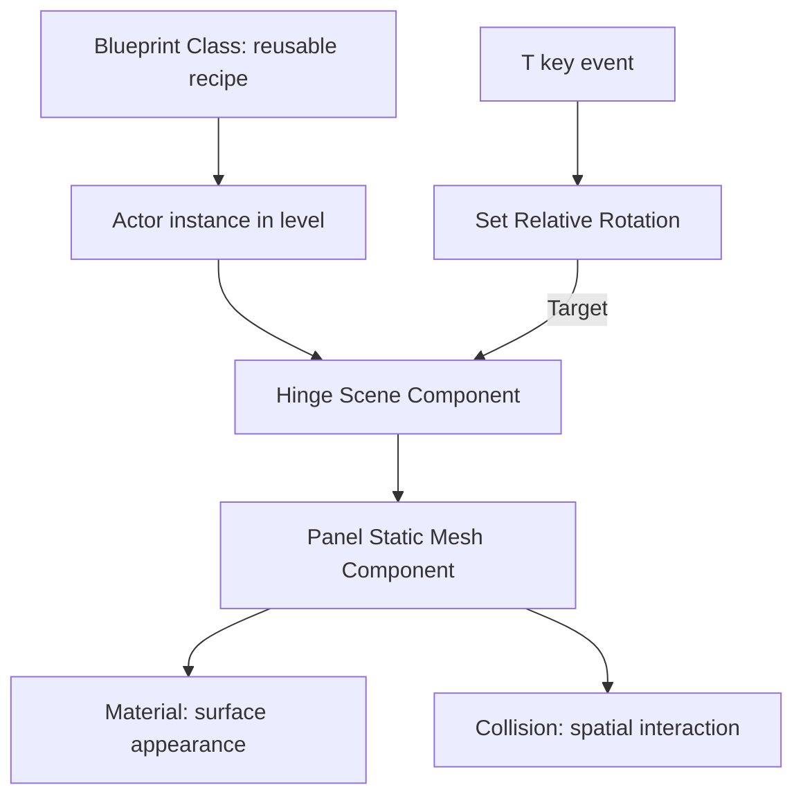

**Say it back:** “My level contains a trapdoor Actor instance. Its Blueprint defines a Hinge and panel. An event runs an operation that rotates the hinge.”

## Official Unreal Engine 5.8 learning map

Start with [Epic's official UE 5.8 documentation](https://dev.epicgames.com/documentation/unreal-engine/unreal-engine-5-8-documentation). Its verified landing page lists these sections. Follow the section links from there to keep the version context.

| This guide | Official documentation section to explore |
|---|---|
| Editor, projects, Actors, and transforms | Understanding the Basics |
| Assets, meshes, and materials | Working with Content; Designing Visuals, Rendering, and Graphics |
| Arena layout and levels | Building Virtual Worlds |
| Pillar and trapdoor Blueprints | Blueprints Visual Scripting; Gameplay Tutorials |
| Input and interaction | Gameplay Systems |
| Future C++ work and IDE setup | Programming with C++ |
| Git and collaboration planning | Setting Up Your Production Pipeline |
| Checking the result | Testing and Optimizing Your Content |

This guide provides small learning exercises. Epic's documentation is the reference for supported features, detailed settings, and version-specific behavior.

## Revision and validation notes

- Updated the title and source reference to the verified official UE 5.8 documentation landing page.
- Added a first-session checklist and a diagram key.
- Expanded explanations of world versus relative transforms, Blueprint execution versus data flow, hinge geometry, input tracing, and a small Colosseum test layout.
- The diagrams are conceptual Mermaid diagrams, not captured Editor screenshots.
- The exact 5.8 subpage instructions could not be checked during this revision because detailed retrieval failed.
- No Unreal project or Blueprint assets were changed or run by this documentation update.

