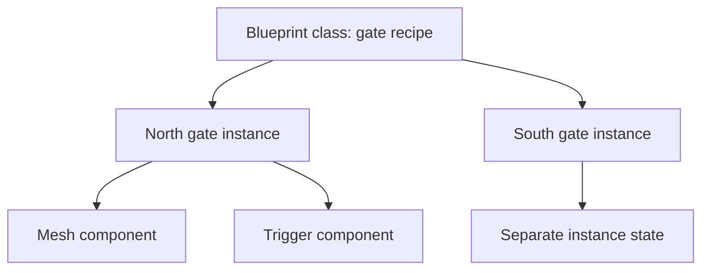
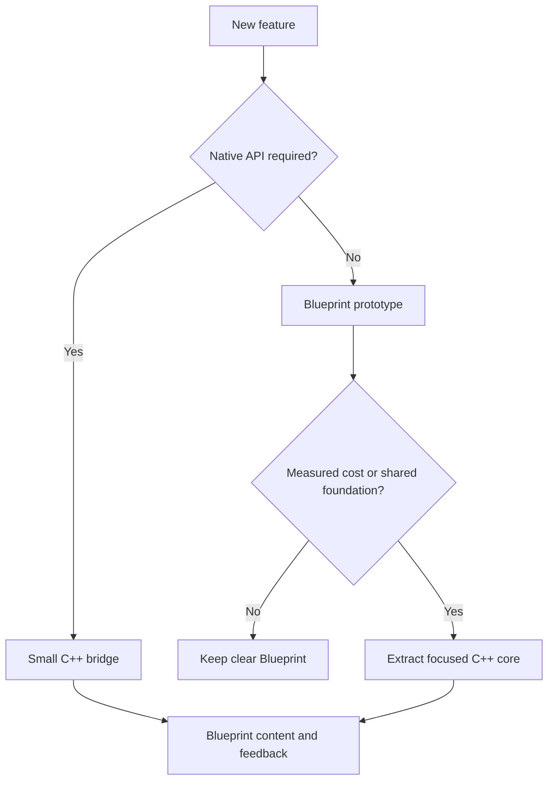

# Unreal Engine & Blueprint Bible
## A plain-English, hands-on reference for the Colosseum team

**Prepared:** November 7, 2026

**Target:** Unreal Engine 5.8 family; check your installed patch in Help → About Unreal Editor.

**Audience:** Beginners, Blueprint designers, and developers learning to connect C++ with Blueprint.

**Scope:** Learning reference and proposed practices, not a change to the team's game architecture.

> Start small. Make one thing happen. Explain it aloud. Then add the next thing. A hundred disconnected nodes do not count as progress just because they look like a subway map.

**Validation:** This book was checked against the repository and Epic's documentation. The exercises and C++ example have **not** been compiled or run in Unreal Editor here. Menu placement and node presentation can differ between patches and templates. This document does not install code, create Blueprint assets, or change project settings.

The repository's `ColosseumV3.uproject` associates with `5.8` and currently declares no project C++ modules. That is an observation about this revision, not a promise that every team member's local installation is identical. Start the C++ exercise in a separate practice project.

## How to use this book without reading it all

Use a **10–20 minute session**:

1. Choose one goal from the table below.
2. Read its **Idea** and **Do it** sections.
3. Perform the steps in Unreal.
4. Check the **Visible result**.
5. Say aloud what changed and why.
6. Save and stop. Stopping at a working checkpoint is a skill.

If a chapter feels too large, do only the first numbered group. You can return later; the cube will wait.

| I want to… | Go to |
|---|---|
| Make my first Blueprint do something | [4. First Blueprint](#4-first-blueprint-make-a-cube-say-hello) |
| Understand the wires | [5. Read a graph](#5-read-a-blueprint-graph) |
| Understand variables and functions | [6. Variables](#6-variables-the-objects-memory), [8. Functions](#8-functions-events-macros-and-flow-control) |
| Make a door open | [11. Trapdoor lab](#11-trapdoor-lab-overlap-and-smooth-motion) |
| Make E interact with an object | [12. Interaction lab](#12-interaction-lab-press-e-to-operate-an-object) |
| Fix WASD/QE | [13. Input and movement](#13-enhanced-input-and-wasdqe) |
| Decide between Blueprint and C++ | [19. Decision guide](#19-when-to-use-blueprint-and-when-to-use-c) |
| Build my first hybrid feature | [20. C++ health lab](#20-complete-hybrid-lab-c-health-with-blueprint-feedback) |
| Make an AI cross a gap | [16. Navigation](#16-ai-navigation-and-smart-links) |
| Work without overwriting teammates | [23. Git and team ownership](#23-git-lfs-and-team-ownership) |
| Find why something failed | [22. Debugging](#22-debugging-find-the-first-broken-link), [26. Troubleshooting](#26-troubleshooting-table) |

## Contents

1. [The engine's building blocks](#1-the-engines-building-blocks)
2. [Editor survival kit](#2-editor-survival-kit)
3. [Safe practice project](#3-set-up-a-safe-practice-project)
4. [First Blueprint](#4-first-blueprint-make-a-cube-say-hello)
5. [Read a graph](#5-read-a-blueprint-graph)
6. [Variables](#6-variables-the-objects-memory)
7. [References and casting](#7-references-classes-instances-and-casting)
8. [Functions and flow](#8-functions-events-macros-and-flow-control)
9. [Lifecycle and time](#9-construction-beginplay-tick-and-timers)
10. [Components, transforms, and collision](#10-components-transforms-and-collision)
11. [Trapdoor lab](#11-trapdoor-lab-overlap-and-smooth-motion)
12. [Interaction lab](#12-interaction-lab-press-e-to-operate-an-object)
13. [Enhanced Input](#13-enhanced-input-and-wasdqe)
14. [Gameplay Framework](#14-gameplay-framework-who-should-own-this)
15. [Communication](#15-blueprints-talking-to-each-other)
16. [AI and Smart Links](#16-ai-navigation-and-smart-links)
17. [UI and saving](#17-ui-and-save-games)
18. [Materials, animation, and audio](#18-materials-animation-and-audio)
19. [Blueprint or C++?](#19-when-to-use-blueprint-and-when-to-use-c)
20. [Complete hybrid C++ lab](#20-complete-hybrid-lab-c-health-with-blueprint-feedback)
21. [Architecture and performance](#21-architecture-and-performance-without-guesswork)
22. [Debugging](#22-debugging-find-the-first-broken-link)
23. [Git, LFS, and team work](#23-git-lfs-and-team-ownership)
24. [Build and package](#24-build-cook-package-and-test)
25. [Learning plan and challenges](#25-a-learning-plan-with-visible-results)
26. [Troubleshooting table](#26-troubleshooting-table)
27. [Glossary](#27-plain-english-glossary)
28. [Official references](#28-official-references)

## 1. The engine's building blocks

**Idea:** The project is the production. A map is the stage. Actors are things on that stage. Components give those things capabilities.

| Term | Plain English | Colosseum example |
|---|---|---|
| Project | The collection of settings, content, and optional code | ColosseumV3 |
| Level / map | A world you open or load | Arena practice map |
| Actor | An object that can exist in a world | Gate, torch, guard |
| Component | A reusable part owned by an Actor | Light, mesh, collision box |
| Scene Component | A component with a transform | Door hinge |
| Static Mesh | Geometry generally used without a skeleton | Stone wall |
| Skeletal Mesh | Geometry driven by a skeleton | Gladiator body |
| Material | Instructions for a surface's appearance | Sand or marble |
| Blueprint Class | A reusable visual class definition | BP_TrainingGate |
| Instance | One object created from a class | The north gate |
| Pawn | An Actor a Controller can possess | Flying inspection camera |
| Character | A Pawn with a capsule and character movement facilities | Walking visitor |
| Controller | Directs a Pawn | PlayerController or AIController |
| Asset | A saved resource | Mesh, material, Blueprint |



Changing a **class default** can affect instances that have not overridden that property. Changing an **instance property** affects that placed object. Deleting an instance from a map does not delete its Blueprint asset; deleting the asset can break references elsewhere.

**Try it:** Place two copies of a cube Blueprint. Change the Location of one. Both use the same recipe, but their world positions are separate.

**Visible result:** Two related objects, only one moved.

**Say it:** “Class means recipe. Instance means one actual copy.”

## 2. Editor survival kit

| Place | What you use it for | If you cannot find it |
|---|---|---|
| Level Viewport | See and select world objects | Open the level's viewport tab |
| Outliner | Find placed Actors | Window → Outliner |
| Details | Edit the selected item | Window → Details; select something |
| Content Browser / Drawer | Find saved assets | Open Content Drawer; Ctrl+Space is a common default |
| Blueprint Viewport | Arrange a Blueprint's components | Open a Blueprint Class, select Viewport |
| Components panel | Select mesh, hinge, collision, etc. | Open the Blueprint editor's Components panel |
| My Blueprint | Variables, functions, events | Window menu in Blueprint editor |
| Event Graph | Runtime visual logic | My Blueprint → EventGraph |
| Output Log | Read warnings and diagnostic messages | Window → Developer Tools → Output Log, or search the Window menu |
| World Settings | Map-specific settings and GameMode override | Window → World Settings |

**Three different selections:** Selecting an Actor in the level, a component inside its Blueprint, and a graph node produces three different Details panels. “Details is empty” often means the wrong thing is selected.

**Useful habits:** Save before Play. Compile after editing Blueprint logic. Read compile errors before changing more nodes. Use F to frame a selected world object. Undo one action at a time and check the result.

**Play versus Simulate:** Play normally starts the gameplay experience and can possess a Pawn. Simulate lets the world run while you inspect it; it does not automatically prove that player possession and input work. Test player controls in Play first.

**Visible result:** Select a cube, change Z by 100, and see it move upward by one meter under the normal centimeter unit convention.

## 3. Set up a safe practice project

**Goal:** A separate sandbox where mistakes cannot overwrite the team's active maps.

1. Launch the team's agreed Unreal installation.
2. Create a Games → Third Person **Blueprint** project, where that template is available.
3. Name it `Colosseum_Learning`.
4. Choose a folder outside the team's working project.
5. Create it and press Play.
6. Click inside the viewport and verify basic movement.
7. Stop Play.
8. Create `Content/Learning/Blueprints`, `Maps`, `Input`, `UI`, and `Materials` folders.
9. Save a practice copy of the template map under `Content/Learning/Maps/L_Learning`.
10. Keep the template's working character, input, and GameMode until you understand them.

**Visible result:** A moving character in a saved practice map.

**If stuck:** Check the map's World Settings and Project Settings → Maps & Modes. The default Pawn must be a usable player Pawn. A Player Start inside geometry can create spawn trouble.

**Important:** A Git branch is not a second physical project folder. Switching branches with the Editor open can leave loaded assets inconsistent with disk. Close the Editor first.

## 4. First Blueprint: make a cube say hello

**Goal:** One Actor prints one message when play starts.

1. In `Learning/Blueprints`, right-click empty space.
2. Choose Blueprint Class → Actor.
3. Name it `BP_HelloCube`.
4. Open it.
5. In Components, Add → Static Mesh. Name the component `CubeMesh`.
6. Select CubeMesh. In Details, assign an engine basic cube mesh; enable engine content in the browser if you need to locate it.
7. Open Event Graph.
8. Find `Event BeginPlay`; if absent, right-click and search for it.
9. Drag from BeginPlay's white execution output and add `Print String`.
10. Set In String to `Hello from the arena!`.
11. Set Duration to about 5 seconds.
12. Compile and Save.
13. Return to the level and drag BP_HelloCube into it.
14. Press Play.

| Node | Pin or value | Connect to |
|---|---|---|
| Event BeginPlay | White execution output | Print String execution input |
| Print String | In String | `Hello from the arena!` |

**Visible result:** A cube and one message per placed instance at startup. Three cubes can produce three messages. That is three Actors working, not a haunted printer.

**If nothing happens:** Is the Blueprint placed in this map? Did it compile? Are you playing the correct map? Is Print to Screen enabled? Also check Output Log. Print String is a development aid and is not a shipping UI.

**Try it:** Duplicate the cube, change its instance label, and count startup messages.

## 5. Read a Blueprint graph

**Idea:** A Blueprint is programming. The language uses nodes, pins, types, and execution flow rather than typed statements.

| Graph feature | Meaning | Common mistake |
|---|---|---|
| White execution wire | Which operation happens next | Assuming nearby nodes run automatically |
| Data wire | A value supplied to another node | Assuming data wires schedule execution |
| Input pin | Information a node receives | Supplying the wrong type |
| Output pin | Information a node produces | Treating a reference as a new object |
| Pure node | Calculates or retrieves data without an execution pin | Assuming it runs only once or caches its result |
| Impure node | Participates in execution flow | Leaving its execution input disconnected |
| Target pin | The object this operation acts upon | Calling on Self instead of the intended door |
| Return Value | Result produced by an operation | Ignoring failure or an empty result |

Pin colors help, but **read the pin's type tooltip**. Colors alone are not a reliable type system for learning, themes, or accessibility.

### A small worked example

Intention: “If health is above zero, print Alive. Otherwise print Defeated.”

1. Create a Float variable `Health`, default 100.
2. Drag Health into the graph as Get.
3. Drag its output and search for the Float `>` comparison.
4. Set the other operand to 0.
5. Add a Branch.
6. Connect BeginPlay's execution output to Branch.
7. Connect the comparison Boolean to Condition.
8. Connect True to Print String `Alive`.
9. Connect False to a different Print String `Defeated`.

**Visible result:** 100 prints Alive; a default of 0 prints Defeated after you stop, change the default, compile, and play again.

**Reading rule:** Follow white wires to understand order. Follow data wires to understand values. A Sequence executes its Then outputs in order; it does not choose a route based on meaning and does not make asynchronous work finish before the next output starts.

## 6. Variables: the object's memory

| Type | Stores | Example | Watch out for |
|---|---|---|---|
| Boolean | True or false | bIsOpen | Two unrelated Booleans can allow impossible states |
| Integer | Whole number | RemainingGuards = 3 | Integer division discards the fractional part |
| Float / real number | Number with a fractional part | OpenDuration = 1.5 | Exact equality can be unreliable after calculations |
| String | General text data | A debug message | Prefer Text for player-facing localized words |
| Text | Display text with localization support | “Open gate” | Not the same purpose as an identifier |
| Name | Identifier | ArenaNorth | Do not use a display label as a permanent identity |
| Vector | X, Y, Z values | A position or direction | A position and a direction have different meanings |
| Rotator | Orientation | A hinge's rotation | Unreal's roll/pitch/yaw axes must match your hinge |
| Transform | Location, rotation, scale together | A saved pose | Know whether it is local or world space |
| Object reference | An actual object | TargetGate | Can be unassigned or become invalid |
| Class reference | A type to create or inspect | GuardClass | Is not an already spawned guard |
| Enum | One named choice | Closed, Opening, Open, Closing | Add explicit handling when you introduce new choices |
| Struct | Related values grouped together | Guard name, health, patrol route | Avoid giant structs that mix unrelated systems |
| Array | Ordered list | PatrolPoints | Indexes start at 0; check bounds |
| Set | Unique values | CollectedKeyIDs | No useful guaranteed positional order |
| Map | Key-to-value lookup | GateID → gate state | Decide what to do when the key is missing |

### Make an instance-editable variable

1. Open BP_HelloCube.
2. In My Blueprint, add a String variable `Greeting`.
3. Compile, then set default `Hello visitor!`.
4. Enable Instance Editable using the variable's Details setting or eye icon.
5. Connect Get Greeting to Print String's In String.
6. Compile and Save.
7. Place two instances in the level.
8. Select each instance and give it a different Greeting in Details.
9. Play.

**Visible result:** Two cubes give different greetings using the same Blueprint class.

**Get versus Set:** Get reads the current value. Set changes it. Adding 10 to a value does not store the result unless you connect it to a Set or another operation that uses it.

### Health calculation with actual numbers

`NewHealth = Clamp(OldHealth - Damage, 0, MaxHealth)`

With health 40 and damage 15: result 25. With health 10 and damage 15: result 0. Clamp keeps the value between limits. Validate negative damage rather than accidentally turning “damage” into healing.

**Try it:** Build the subtraction and Clamp nodes, Set Health, then print the stored Health. Compare your prediction to the actual result.

### Array lab: inspect a small patrol route

1. Add a Vector variable `PatrolPoints` and change its container type to Array.
2. Compile, then add three default elements: `(0, 0, 0)`, `(200, 0, 0)`, `(200, 200, 0)`.
3. From a separate one-time test event, connect a ForEachLoop using Get PatrolPoints as Array.
4. From Loop Body, print Array Index and Array Element using Format Text or appropriate string conversions.
5. From Completed, print `Route inspected`.
6. Play and run the test once.

**Visible result:** Indexes 0, 1, 2 print their corresponding vectors, then the completion message. These are just stored coordinates; no AI moves until you implement movement.

**Important:** Use Is Valid Index before reading a user-selected array index. A length of 3 permits indexes 0–2, not index 3. Decide whether patrol positions are world coordinates or offsets and keep that convention consistent.

## 7. References, classes, instances, and casting

**Idea:** Knowing the word “gate” is not the same as knowing which gate to operate.

A `BP_TrainingGate Object Reference` can point to the north gate in the current world. A `BP_TrainingGate Class Reference` describes the type used to spawn a new gate. A variable with a type but no assigned object is commonly `None`.

### Assign a placed Actor reference

1. Create an Actor Blueprint `BP_GateSwitch`.
2. Add an Object Reference variable `TargetGate` of your gate Blueprint type.
3. Enable Instance Editable.
4. Place the switch and gate in the level.
5. Select the switch instance.
6. Use TargetGate's picker or eyedropper to select the placed gate.
7. Before using TargetGate at runtime, check it with `Is Valid`.
8. If invalid, print `TargetGate is not assigned` rather than silently doing nothing.

**Visible result:** The switch identifies one specific gate. A second switch can point to a different gate.

### Casting explained

A cast asks: “Is this existing object this type, or a child of this type?” A successful cast lets you access that type's members. A cast does **not** spawn an object, locate one in the level, or turn an unrelated object into a different class.

Example: an overlap gives you `Other Actor`. Cast that existing reference to the template player character class. Success means this overlapped object is that character type. Failure can be entirely normal when another object enters.

**Self:** Inside BP_GateSwitch, Self is that switch instance. Inside the gate, Self is that gate instance. Self is not automatically the player.

**Avoid:** Calling Get All Actors of Class every frame to find one gate. Assign a reference once, inject it when spawning, or use an appropriate registration system.

### Spawn lab: a class becomes a new instance

1. Create a separate Actor Blueprint `BP_TrainingSpawner`.
2. Add a Class Reference variable `SpawnClass`, constrained to Actor, and set its default to BP_HelloCube.
3. From its BeginPlay, add Spawn Actor from Class.
4. Connect SpawnClass to Class.
5. Supply a Make Transform whose Location is the spawner's world location plus `(0, 0, 150)`.
6. Choose a collision handling policy intentionally; for this nonblocking cube demonstration, an explicit Always Spawn policy is acceptable. Do not blindly reuse that policy for player characters inside walls.
7. Store the returned Actor reference and validate it before use.
8. Place one spawner in the level and Play.

**Visible result:** A new runtime cube appears above the spawner and runs its own BeginPlay greeting. It disappears when the play session ends because a runtime spawn is not automatically saved into the map asset.

**Destroy Actor:** Removes the selected runtime Actor through Unreal's lifecycle; it does not delete its Content Browser asset. References to destroyed Actors must no longer be treated as usable.

## 8. Functions, events, macros, and flow control

| Tool | Use it when | Example | Boundary |
|---|---|---|---|
| Function | You want a named operation, often with inputs/outputs | CalculateDamage | Normal Blueprint functions cannot contain latent Delay or Timeline nodes |
| Pure function | You calculate a value without changing state | GetHealthFraction | Keep it free of side effects and repeated expensive work |
| Custom Event | You need an execution entry point | StartArenaRound | Can start latent work in a suitable event graph |
| Macro | You need reusable graph flow with suitable execution pins | A small validation pattern | Expanded graph logic; not a free performance improvement |
| Branch | Choose based on a Boolean | Is the door unlocked? | Must connect Condition |
| Sequence | Run output paths in order | Start sound, then request a UI update | Does not wait for latent tasks on the first path |
| DoOnce | Allow one execution until reset | Award a one-time key | Must plan who resets it |
| Gate node | Allow or block execution pulses | Allow interaction while a round runs | Its state must be managed |
| ForEachLoop | Process an array | Tell all registered gates to close | A large loop can hitch; Delay is not a per-iteration scheduler |
| Switch on Enum | Choose a named state | Closed / Opening / Open | Better readability than a pile of overlapping flags |
| Select | Choose a value | Red or green color | Does not execute a gameplay action by itself |

### Make a reusable function

1. In BP_HelloCube, add a function `PrintGreeting`.
2. Add an input `Message` of type String.
3. Connect the function entry execution to Print String.
4. Connect Message to In String.
5. Return to Event Graph.
6. Call PrintGreeting from BeginPlay, using `Welcome to training`.

**Visible result:** The same message, now behind a name that explains the operation.

**Good function names:** OpenGate, ApplyTrainingDamage, GetHealthFraction. A function named `DoStuff2` is tomorrow's mystery box.

**When to collapse:** Extract a meaningful action used repeatedly or obscuring the graph. Do not split every single node into a function just to inflate the function list.

## 9. Construction, BeginPlay, Tick, and timers

| Mechanism | When it is useful | Do not assume |
|---|---|---|
| Construction Script | Update an Actor's editable layout or appearance | It runs once or is suitable for saving files and starting gameplay |
| BeginPlay | Initialize gameplay for a participating Actor | Every other Actor has already finished initializing |
| Tick | Work needed each frame | Every feature needs it |
| Timer | Scheduled or repeated work | It is a hard real-time clock or automatically synchronized over a network |
| Timeline | A value changing over a designed duration | Its output is automatically applied to anything |
| EndPlay | Clean up gameplay participation | It only happens when you explicitly Destroy an Actor |

### Timer lab: count every second

1. In BP_HelloCube, add Integer `PulseCount`, default 0.
2. Add Custom Event `Pulse`.
3. Pulse gets PulseCount, adds 1, sets PulseCount, then prints it.
4. From BeginPlay, add Set Timer by Event.
5. Set Time to 1.0 and Looping true.
6. Connect its event delegate to Pulse; the delegate pin is not a white execution wire.
7. Store the returned Timer Handle if you will stop it later.
8. Play.
9. To stop it, call Clear and Invalidate Timer by Handle using the saved handle.

**Visible result:** Roughly one new count per second, without Tick.

**Time-based movement:** If manually moving a distance every frame, calculate `Speed × DeltaSeconds`. A speed of 200 cm/s over 0.5 seconds moves 100 cm. Do not multiply `Add Movement Input`'s normal axis value by DeltaSeconds in the usual CharacterMovement setup; that movement system already handles time integration.

## 10. Components, transforms, and collision

### Transforms without the headache

| Concept | Means | Example |
|---|---|---|
| World location | Position in the level's coordinate system | The gate is at arena X = 2000 |
| Relative location | Position relative to the parent component | Panel sits 100 cm from its hinge |
| Local direction | Direction in the object's own orientation | Gate's forward vector |
| World direction | Direction in the world's axes | World up is positive Z |
| Attachment | Parent-child transform relationship | Panel follows a hinge |
| Pivot / origin | Point about which transforms act | Door rotates around its edge |

Unreal normally uses centimeters for distance and degrees for Rotators. X is commonly forward, Y right, Z up. Imported geometry can have different original axes; verify its orientation.

### Collision: three questions

1. **Is collision enabled for queries, physics, or both?**
2. **Which object or trace channel is involved?**
3. **Should the pair block, overlap, or ignore?**

| Outcome | What it does | Example |
|---|---|---|
| Block | Can prevent movement in relevant collision operations | A solid wall |
| Overlap | Detect intersection without acting as a solid barrier | Door trigger |
| Ignore | No interaction for that pairing/query | Decoration ignoring the player |

For the overlap exercises, use query collision, configure the box to overlap Pawn, and enable Generate Overlap Events on the participating components. Both sides' configuration matters. A visually touching mesh is not proof that the collision shapes overlap.

For physics-driven hit events, additional settings such as Simulation Generates Hit Events can be relevant. Blocking, overlap notifications, physics simulation, and navigation are separate concerns.

**Try it:** Put a Box Collision around a cube. Add its On Component Begin Overlap event, print Other Actor's display name, then walk through it.

**Visible result:** The character can pass through the box while a diagnostic message appears.

**Multiple messages?** One Actor can have multiple overlapping components. Filter to the intended Actor/component or track unique occupants. One begin/end pair per Actor is not guaranteed by an unfiltered component setup.

## 11. Trapdoor lab: overlap and smooth motion

**Goal:** Walking into a trigger opens a hinged panel; leaving closes it.

**Scope:** Single-player practice. This is not a finished multiplayer or physics-safe production trapdoor. Build it beside the player first, not under the only spawn point.

### A. Build a hinge that actually hinges

1. Create Actor Blueprint `BP_TrainingTrapdoor`.
2. Keep a DefaultSceneRoot.
3. Add Scene Component `Hinge` attached to the root.
4. Add Static Mesh `DoorPanel` attached to Hinge.
5. Assign a basic 100 cm cube mesh to DoorPanel.
6. Set DoorPanel's relative Scale to approximately `(2, 2, 0.1)`.
7. Set DoorPanel's relative Location to `(0, 100, 0)` so one edge lies near the hinge's X axis.
8. Leave Hinge at `(0, 0, 0)` with zero rotation.
9. Set DoorPanel Mobility to Movable; leave Simulate Physics off.
10. Add Box Collision `Trigger` attached to the root, **not** DoorPanel.
11. Position its center near `(0, 100, 100)` and set Box Extent approximately `(150, 150, 150)`.
12. Set Trigger collision to query overlaps with Pawn, with Generate Overlap Events enabled.
13. Configure DoorPanel to block the player if it should serve as a solid panel.

**Checkpoint:** Rotate Hinge's Roll manually in the Blueprint Viewport. The panel should swing around its edge. Reset Roll to 0 before continuing. If it spins around its center, fix attachment and offset now.

### B. Create an opening value

1. In Event Graph, add Timeline `TL_Open`.
2. Open the Timeline and add Float track `Alpha`.
3. Set Timeline Length to 1.0 second.
4. Add a key at Time 0, Value 0.
5. Add another at Time 1, Value 1.
6. Use linear interpolation for a predictable first test.
7. Return to Event Graph.
8. Add Lerp (Float), A = 0, B = -80.
9. Connect TL_Open's Alpha output to the Lerp's Alpha input.
10. Add Make Rotator; connect the Lerp result to **Roll**. Keep Pitch and Yaw at 0.
11. Drag Hinge from Components into the graph.
12. Add Set Relative Rotation targeting Hinge.
13. Connect Timeline Update execution to Set Relative Rotation.
14. Connect Make Rotator to New Rotation.

**Why Roll?** This example aligns the hinge with local X. Roll rotates about X. A different component orientation may require a different axis or sign.

### C. Connect the trigger

1. Select Trigger and add On Component Begin Overlap.
2. Compare Other Actor with Get Player Character, Player Index 0.
3. Branch on equality. This exercise intentionally accepts only the local player character.
4. On True, call TL_Open → Play.
5. Add Trigger's On Component End Overlap.
6. Apply the same player filter.
7. On True, call TL_Open → Reverse.
8. Compile, Save, and place the Blueprint near the player.
9. Play and walk into and out of the trigger.

**Visible result:** Panel swings down toward -80 degrees and returns toward 0. Play/Reverse let it change direction from its current Timeline position.

**If it flickers:** Use only the character capsule for trigger overlap or maintain a Set of valid overlapping Actors with carefully paired component handling. The simple lab assumes one relevant collision component on the character.

**If it opens the wrong way:** Change the end angle to +80, then test. Do not randomly reconnect five wires at once.

**Safety/design limitation:** Moving a rotating panel this way does not provide a complete swept collision or obstruction solution. Prevent closing on occupants and test movement/collision before using it as a walkable trapdoor.

**Try it:** Expose `OpenAngle` as a Float and connect it to Lerp B. Give two instances different angles.

## 12. Interaction lab: press E to operate an object

**Goal:** The player looks at a gate, presses E, and sends an interaction message.

**Prerequisites:** A functioning template character and the Enhanced Input basics in chapter 13. Complete that chapter first if you have not created an Input Action before.

### A. Define a shared capability

1. Create Blueprint Interface `BPI_Interactable`.
2. Add function `Interact` with input `Interactor`, type Actor Object Reference.
3. Give it no output for this first exercise.
4. Compile and Save.
5. Open BP_TrainingTrapdoor → Class Settings.
6. Add BPI_Interactable under Implemented Interfaces.
7. Compile, then add Event Interact in the Event Graph.
8. For this exercise, disconnect the overlap paths from the Timeline so two control systems are not competing.
9. Add Boolean `bRequestedOpen`, default false.
10. In Event Interact, Set bRequestedOpen to NOT bRequestedOpen.
11. Branch on the new value: True → Timeline Play; False → Timeline Reverse.

Here bRequestedOpen records the requested destination, not proof that the panel has reached it. Use a state enum or Timeline completion handling when gameplay needs the exact physical state.

### B. Send the message from the player

1. Create Boolean Input Action `IA_Interact`.
2. Add E → IA_Interact in the player's active Input Mapping Context.
3. In the possessed player character's Event Graph, add the IA_Interact event.
4. Use **Started** so one press requests one interaction.
5. Get the player camera's World Location as Start.
6. Get that camera's Forward Vector.
7. Multiply Forward Vector by 300, then add Start. This is End, about 3 meters ahead.
8. Add Line Trace by Channel, using Start and End, Visibility channel, Ignore Self true.
9. For testing, enable temporary debug drawing on the trace.
10. Branch on the trace Return Value.
11. On True, Break Hit Result and take Hit Actor.
12. Check Does Implement Interface for BPI_Interactable.
13. On True, send **Interact (Message)** to Hit Actor, passing Self as Interactor.
14. Ensure the target mesh blocks the Visibility trace channel.

**Visible result:** Aim at the panel and press E once; it changes its requested open/closed direction. Aim away and E does nothing.

**If nothing happens:** Print once at IA_Interact Started, once after a successful trace, and once inside Event Interact. The first missing print identifies the broken stage.

**Why an interface?** A gate, lever, and information plaque can all accept Interact without the player depending on each concrete Blueprint class. An interface does not automatically find targets or broadcast to the whole world.

## 13. Enhanced Input and WASD/QE

**Idea:** A key is mapped to an action. An active context supplies that mapping. A possessed Pawn responds to the action.

| Asset/system | Job | Example |
|---|---|---|
| Input Action | Defines a semantic action and value type | IA_Move, Axis2D |
| Input Mapping Context | Maps hardware controls to actions | IMC_Learning |
| Input Modifier | Changes the incoming value | Negate or Swizzle |
| Input Trigger | Controls when an action qualifies | Hold or Pressed behavior |
| Enhanced Input Local Player Subsystem | Holds contexts for that local player | Add Mapping Context |
| Pawn / Controller | Receives input and routes behavior | Visitor Character |

### A. Extend a working template first

1. Find the template character and existing Input Mapping Context.
2. Inspect how its movement already works before replacing it.
3. Create IA_Interact as Boolean and add E in that context for chapter 12.
4. Add its Started event in the possessed character and print `Interact pressed`.
5. Play, click the viewport, press E.

**Visible result:** One message per press. Prove this before adding a trace or gate.

### B. Build an Axis2D mapping deliberately

For a new digital-key movement action, the raw key contribution starts on X. These mappings create `(right, forward)`:

| Key | Raw starting value | Modifiers, in this order | Desired result |
|---|---|---|---|
| D | Positive X | None | X = +1, Y = 0 |
| A | Positive X | Negate X | X = -1, Y = 0 |
| W | Positive X | Swizzle Input Axis Values, YXZ | X = 0, Y = +1 |
| S | Positive X | Negate X, then Swizzle YXZ | X = 0, Y = -1 |

Inspect the actual action value while testing. Different modifier ordering or starting values can produce different results.

In the Character:

1. Read IA_Move's Vector2D value from its Triggered event.
2. Get Control Rotation and keep only Yaw for ground-relative movement.
3. Get Forward Vector from that yaw-only Rotator.
4. Get Right Vector from the same Rotator.
5. Add Movement Input with Forward Vector and Scale Value = action Y.
6. Add Movement Input with Right Vector and Scale Value = action X.
7. Set movement speed through CharacterMovement settings rather than arbitrary axis multipliers.

**Visible result:** W/S move forward/back; A/D strafe relative to view yaw.

### C. If creating a new mapping context

From an appropriate local-player initialization path, get the PlayerController's Local Player and its Enhanced Input Local Player Subsystem, validate it, then Add Mapping Context with your IMC and priority. Template projects may already do this. Do not add the same mapping again in several Blueprints. Remote/non-local controllers are not a substitute for the local player's subsystem.

### D. Q/E vertical movement

For an inspection camera, start with a **SpectatorPawn** or a Pawn with a properly configured **FloatingPawnMovement** component. Add a Float/Axis1D action `IA_MoveVertical`: E = +1, Q = -1 using Negate for Q. Feed its value to Add Movement Input with World Direction `(0, 0, 1)`.

On a Character using Walking movement, upward input does not automatically produce free flight. Use Jump for a walking character, or deliberately switch an inspection Character to Flying with appropriate settings. A plain Actor's Add Movement Input does not create a movement system.

**If using E for both interaction and up:** Pick a different key or separate contexts/modes. Two features sharing one key can be valid, but not by accident.

### E. Input prints but movement does not happen

Check in this order:

1. Are you in Play and controlling the intended Pawn?
2. Is the input graph on that Pawn or an intentional controller path?
3. Is the Mapping Context active?
4. Does the action output change as expected?
5. Does a movement component exist and is it active?
6. Is movement mode suitable—Walking versus Flying?
7. Is collision blocking the Pawn?
8. Are the direction vectors nonzero and on the intended axes?

`showdebug enhancedinput` is a useful development console diagnostic where supported. Verify your controls in Play before interpreting behavior in Simulate.

## 14. Gameplay Framework: who should own this?

**Idea:** Put a responsibility where it belongs. A single giant Level Blueprint becomes hard to reuse and easy to collide with in Git.

| Owner | Good responsibility | Colosseum example |
|---|---|---|
| Actor | One world object's behavior | A particular gate opens |
| Actor Component | Reusable behavior attached to different Actors | HealthComponent |
| Pawn / Character | The controlled body's movement and capabilities | Visitor walks or jumps |
| PlayerController | Player intent and control coordination | Interaction requests |
| AIController | AI control of a Pawn | Guard patrol decisions |
| GameMode | Game rules; server-side authority in network play | Determine whether a round may start |
| GameState | Shared match state intended for replication | Current round and time |
| PlayerState | Per-player game data intended to persist across Pawn changes | Score |
| GameInstance | Application-session state across normal map changes | Selected visitor profile |
| SaveGame | Data deliberately persisted between sessions | Unlocked exhibits |
| Widget | Presentation and UI interactions | Health bar |
| Level Blueprint | Map-specific orchestration | A one-off scene cue |

**Example:** A gate owns its opening behavior. An arena coordinator requests all registered gates to close. A widget displays round status. The widget should not secretly own the authoritative round rules.

GameInstance is not automatically saved to disk and is not automatically replicated. GameMode is not a shared object clients can freely read in multiplayer. Placement in the framework matters as much as the nodes you choose.

**Try it:** Write one responsibility for each of your proposed Blueprints before adding nodes. If every sentence begins “manages everything,” split the design.

## 15. Blueprints talking to each other

| Method | Use when | Example | Cost or trap |
|---|---|---|---|
| Direct reference | You know the particular target | Switch opens north gate | Assignment and lifetime must be handled |
| Cast | You already have an object and need its concrete API | Check whether overlap is the visitor class | Couples the caller to that class |
| Blueprint Interface | Many types support the same request | Interact with gate or plaque | Still needs a target reference |
| Event Dispatcher | A source announces a change to listeners | Health changes; UI and sound respond | Bind deliberately; avoid duplicate subscriptions |
| Shared subsystem / coordinator | A service has a clear broader scope | Track registered arena gates | Can become an everything-manager |

### Dispatcher lab: a gate announces completion

1. In the trapdoor, add Event Dispatcher `OnDoorOpened`.
2. At Timeline Finished, check its final Alpha or a reliable final-state value.
3. Call OnDoorOpened only when the open end was reached, not when reversing finishes closed.
4. In a separate listener Blueprint, create an instance-editable trapdoor reference.
5. Assign it in the level.
6. In the listener's BeginPlay, validate the reference and Bind Event to OnDoorOpened.
7. Create the matching listener event and print `Gate is fully open`.
8. Test opening and closing.

**Visible result:** One completion message on opening, none on closing.

**Important:** A dispatcher does not remember past broadcasts for late listeners. After binding, read the current state once so the listener starts with the right display. If a listener rebinds during its lifetime, unbind or guard against duplicate binding.

## 16. AI navigation and Smart Links

**Idea:** A NavMesh describes walkable regions. A navigation link connects locations a normal path cannot simply walk between. The link does not automatically invent a jump animation or movement implementation.

### A. Make ordinary walking work first

1. Use a practice Character configured for AI possession by an AIController.
2. Give it valid capsule collision and a suitable movement component.
3. Place a Nav Mesh Bounds Volume around a floor and both target areas.
4. Build/update navigation as appropriate to the map's navigation settings.
5. Press P in the level viewport to visualize navigation, using the default binding.
6. Ensure the AI's start and destination are on reachable navigable surfaces for its agent size.
7. Issue an AI Move To from a suitable Blueprint event.
8. Print success and failure outputs separately.

**Visible result:** The AI walks to a nearby destination on the same connected area. Solve this before adding a gap.

### B. Separate simple links from Smart Links

A NavLinkProxy can contain simple point links and a Smart Link. The visible simple-link endpoints and the Smart Link's relative start/end values are distinct configuration. Moving one does not prove the other moved. Where available, use the proxy's copy-endpoints helper intentionally, then inspect the actual Smart Link values.

**Why ReceiveSmartLinkReached may never fire:** A simple link or another route might be used instead; the Smart Link might not be relevant/enabled; endpoints might not connect usable navigation; or the AI may not be following a path through it.

### C. Create a Blueprint where the event belongs

1. In the Content Browser, create Blueprint Class.
2. Expand All Classes and choose NavLinkProxy.
3. Name it `BP_TrainingJumpLink`.
4. Open the **Blueprint asset** from the Content Browser.
5. Add/override `ReceiveSmartLinkReached` in its Event Graph using the available event/override list.
6. Print the Agent's display name immediately on that event.
7. Place this Blueprint in the level, replacing any test proxy that has no event implementation.
8. Select its instance and find Smart Link settings in Details.
9. Enable Smart Link relevance and ensure the link is enabled at runtime.
10. Configure its actual relative start/end points and direction.
11. In the controlled test, remove or disable alternative simple point links so you can identify the chosen route.
12. Set a destination beyond the gap that makes this link necessary.

**A plain placed NavLinkProxy is not automatically a Blueprint asset.** Double-clicking an Actor in the level may focus it rather than open an editable Event Graph.

### D. Know whether endpoints are right

| Check | What you should see |
|---|---|
| Both platform tops are navigable | Navigation overlay on both landing areas |
| Start endpoint | Near a usable departure point on its platform |
| End endpoint | Near a usable landing point on the other platform |
| Agent dimensions | Enough width and headroom for the AI capsule |
| Direction | The required travel direction is permitted |
| Path test | AI approaches the link, and the event print appears |

A marker looking close in perspective view is not proof. Inspect top/side views and compare world positions. Relative coordinates are measured from the proxy's transform.

### E. Finish traversal deliberately

ReceiveSmartLinkReached gives the Agent and Destination. Your custom traversal must get that agent safely across. When traversal finishes, call `Resume Path Following` on the same proxy for that Agent to hand path control back.

For the first diagnostic, print the event and temporarily resume immediately; this proves event delivery, not successful gap crossing. For a real jump, design and test launch velocity, movement mode, collision, landing detection, failure handling, and timeout recovery. Do not resume solely after an arbitrary Delay and assume the character landed.

**Visible result:** Separate evidence for (1) route selected, (2) event received, (3) agent landed, and (4) path resumed. Each is a different milestone.

## 17. UI and Save Games

### A. Health bar concept

Health belongs to the gameplay object/component. A widget displays it.

1. Create Widget Blueprint `WBP_TrainingHealth`.
2. Add a Progress Bar named `HealthBar` and mark it as a variable if necessary.
3. Add function `UpdateHealth` with Float inputs Current and Maximum.
4. If Maximum is greater than 0, calculate `Clamp(Current / Maximum, 0, 1)`; otherwise use 0.
5. Set HealthBar Percent to that result.
6. In the local player's UI setup, Create Widget with the appropriate owning PlayerController and Add to Viewport.
7. Store the created widget reference.
8. Call UpdateHealth once for initial values.
9. Bind gameplay health-change notifications to update it subsequently.

**Visible result:** Current 25, Maximum 100 produces a one-quarter-filled bar.

Do not create a new widget every Tick. Validate references and remove/rebuild UI deliberately when its owning player or viewed Pawn changes. A widget reference in one machine is not automatically a network object on another.

### B. Save a simple value

1. Create Blueprint Class derived from SaveGame: `SG_TrainingProgress`.
2. Add Integer `UnlockedExhibits`.
3. From a one-time test event, Create Save Game Object using that class.
4. Cast the result to SG_TrainingProgress if needed, set UnlockedExhibits to 3.
5. Save Game to Slot using slot `TrainingSlot` and User Index 0 for this desktop exercise.
6. Check the success result.
7. Stop and play again using a separate load test path.
8. Does Save Game Exist? If false, use defaults.
9. If true, Load Game from Slot; cast/validate the returned object.
10. Print UnlockedExhibits.

**Visible result:** A later session loads 3. Do not run the “save 3” path before every load test or you have only proved that overwriting works.

A SaveGame contains the data you intentionally store. It does not automatically capture every Actor in the world. For many doors, save stable IDs and states, then apply them to matching runtime objects. Do not rely on a previous session's raw Actor references.

For larger saves, investigate asynchronous saving and design a version field/migration strategy. Async does not eliminate the need to handle success, failure, and conflicting save requests.

## 18. Materials, animation, and audio

These systems cooperate with Blueprint; they are not replacements for gameplay rules.

| System | First practical use | Example lab | Common trap |
|---|---|---|---|
| Material Instance | Tune appearance without rewriting a base material | Change limestone tint | Editing the base changes many users |
| Dynamic Material Instance | Change supported parameters at runtime | Gate glows when usable | Changing an asset parameter is not the same as changing one instance |
| Animation Blueprint | Choose and blend skeletal poses | Idle versus walking guard | Actor movement and animation state can disagree |
| Animation Montage | Play an authored animation sequence under controlled rules | Guard pulls a lever | Visible hand motion does not automatically move the lever |
| Audio Component | Control a sound's playback on an Actor | Gate grinding loop | Starting a loop repeatedly stacks sounds |
| Niagara | Visual effects | Dust at a closing gate | Visual particles do not establish authoritative damage |
| Sequencer | Authored cinematic timing | Introductory arena tour | Not the Blueprint Sequence execution node |

### Tiny material lab

1. Make a practice material with a Vector Parameter named `Tint` connected to Base Color.
2. Create a Material Instance from it.
3. Enable and change Tint in that instance.
4. Assign the instance to one cube.
5. Give another cube a different material instance.

**Visible result:** Two cubes can have different colors while sharing a base material.

For a runtime color change, create and store a Dynamic Material Instance for the intended mesh element and set its named parameter. Confirm the material actually defines that parameter.

**Audio rule:** Start a movement loop when motion starts, stop it when motion stops. Use appropriate attenuation/spatialization for a world sound rather than assuming every sound should play at full volume everywhere.

## 19. When to use Blueprint and when to use C++

**Practical default for this team:** Prototype a small behavior in Blueprint. Put stable shared foundations in C++ when the team can maintain them. Let Blueprint subclasses choose content, tuning, and presentation. Measure before rewriting for speed.

Blueprint can ship real projects. C++ does not automatically make a design good or fast. A poor algorithm is still poor when it wears a semicolon.

### Decision table

| Task | Start with | Why | When to reconsider |
|---|---|---|---|
| Open a door, play sound, tune timing | Blueprint | Immediate visual iteration | Many objects need a shared, maintained native foundation |
| Arrange an Actor's meshes and lights | Blueprint | Designers can see the composition | A procedural system requires lower-level code |
| UI layout and short UI interactions | Widget Blueprint | Visual layout and quick feedback | Shared data/model logic becomes substantial |
| Material appearance | Material system + Blueprint parameters | Specialized renderer workflow | Custom rendering work requires native/shader expertise |
| Shared damage/stat rules | Hybrid | Native API plus editable content | Very small prototype may remain Blueprint |
| Complex algorithms or heavy repeated calculations | C++ after profiling | Better native implementation/control | The actual bottleneck may be rendering or physics instead |
| External C++ library or unavailable engine API | C++ / plugin | Native integration | Existing supported plugin may already solve it |
| Cinematic choreography | Sequencer + Blueprint triggers | Authored visual timing | Gameplay needs an independent robust state machine |
| Small AI prototype | Blueprint / Behavior Tree | Easy to inspect decisions | Shared tasks, scale, or unavailable APIs justify native work |
| Multiplayer rules | Either, with deliberate authority design | Both can express networked gameplay | Complex systems benefit from reviewed native foundations |
| Editor content automation | Editor tools, Blueprint utilities, or Python where supported | Automate authoring | Runtime packaged gameplay is a different environment |
| Team-reviewed shared interfaces | Often C++ | Text diffs and explicit contracts | Team skill and iteration cost can favor Blueprint initially |

### Five questions before choosing

1. **Can I achieve it clearly in Blueprint?** If yes, prototype there.
2. **Do I need an API or library Blueprint does not expose?** If yes, add a small C++ bridge.
3. **Has profiling identified this graph as a bottleneck?** If yes, isolate the costly portion and benchmark a native version.
4. **Will multiple systems depend on a stable contract?** Consider a native base class/component with a small public API.
5. **Who will maintain it?** A system only one absent teammate understands is a project risk in either language.



### Concrete Colosseum split

| Feature | C++ responsibility, if justified | Blueprint responsibility |
|---|---|---|
| Trapdoor | Reusable state/interaction API and shared rules | Meshes, hinge setup, Timeline, sound, dust |
| Gladiator health | Clamp/validate damage; publish health changes | Hit flash, sound, widget presentation |
| Guard movement | Specialized reusable traversal code | Patrol configuration and authored feedback |
| Exhibit interaction | Stable interaction contract | Text, voiceover, highlights |
| Arena round | Rule validation and shared state | Presentation and map-specific cues |

These are **proposed boundaries**, not a claim that the repository already implements them.

### When to stay in Blueprint

Stay when the graph is clear, meets measured performance requirements, is mostly calling engine systems, and the people maintaining it can work confidently. Moving ten event-driven nodes into C++ simply because “professionals use code” buys little.

### When to move a piece into C++

Move when there is a specific reason: unsupported API access, a measured costly loop, a shared algorithm that needs normal code review/testing, a native integration, or a stable foundation with many content variations.

Move **one seam at a time**: define inputs/outputs; record current behavior; implement the focused native operation; call it from the existing Blueprint; compare results; remove the old path only when verified. Avoid a big-bang reparent/rewrite of the team's active assets.

## 20. Complete hybrid lab: C++ health with Blueprint feedback

**Goal:** C++ owns a simple health rule. A Blueprint child chooses a visible mesh and reacts to changes.

**Outcome:** Health starts at 100. After a test delay, 25 damage produces 75; another 100 produces 0. A notification supplies current/max health.

**Boundary:** This is a single-player teaching Actor, not Unreal's full damage framework, a replicated combat system, or a reusable component implementation. The code is supplied as documentation, not installed in ColosseumV3.

### A. Create an independent C++ learning project

1. Confirm the supported compiler/SDK combination for your exact Unreal version using Epic's setup guidance.
2. On Windows, use the team's supported Visual Studio C++ toolchain. Rider can be the editor/IDE while that toolchain remains installed.
3. Create a separate Games C++ practice project named **ColosseumLearning**.
4. Open it and verify that its unmodified template builds and plays.
5. Use Tools → New C++ Class, or the equivalent class wizard in your version.
6. Choose Actor and name the class **TrainingHealthActor**.
7. Let Unreal generate the files and project module.
8. Close Unreal Editor before replacing these class files and making reflected header changes for this exercise.
9. Use the two generated class files as the locations for the following contents.

**Module name matters:** The example assumes the project/module is `ColosseumLearning`, whose export macro is `COLOSSEUMLEARNING_API`. If your generated header uses a different API macro, keep the generated macro. Do not paste a project-specific macro into an unrelated module.

### B. Header: TrainingHealthActor.h

```cpp
#pragma once

#include "CoreMinimal.h"
#include "GameFramework/Actor.h"
#include "TrainingHealthActor.generated.h"

DECLARE_DYNAMIC_MULTICAST_DELEGATE_TwoParams(
    FTrainingHealthChanged, float, CurrentHealth, float, MaximumHealth);

/** Small single-player teaching Actor with clamped health. */
UCLASS(Blueprintable)
class COLOSSEUMLEARNING_API ATrainingHealthActor : public AActor
{
    GENERATED_BODY()

public:
    ATrainingHealthActor();

    /** Applies positive, finite training damage; ignores invalid input. */
    UFUNCTION(BlueprintCallable, Category = "Training|Health")
    void ApplyTrainingDamage(float Amount);

    UFUNCTION(BlueprintPure, Category = "Training|Health")
    float GetCurrentHealth() const { return CurrentHealth; }

    UFUNCTION(BlueprintPure, Category = "Training|Health")
    float GetMaximumHealth() const { return MaxHealth; }

    /** Blueprint listeners may bind to this notification. */
    UPROPERTY(BlueprintAssignable, Category = "Training|Health")
    FTrainingHealthChanged OnHealthChanged;

protected:
    virtual void BeginPlay() override;

    UPROPERTY(EditDefaultsOnly, BlueprintReadOnly, Category = "Training|Health",
        meta = (ClampMin = "1.0", UIMin = "1.0"))
    float MaxHealth = 100.0f;

private:
    UPROPERTY(VisibleInstanceOnly, Category = "Training|Health")
    float CurrentHealth = 0.0f;
};
```

### C. Implementation: TrainingHealthActor.cpp

```cpp
#include "TrainingHealthActor.h"
#include "Components/SceneComponent.h"

ATrainingHealthActor::ATrainingHealthActor()
{
    PrimaryActorTick.bCanEverTick = false;
    SetRootComponent(CreateDefaultSubobject<USceneComponent>(TEXT("Root")));
}

void ATrainingHealthActor::BeginPlay()
{
    // Initialize before Super so Blueprint BeginPlay sees valid health.
    MaxHealth = FMath::IsFinite(MaxHealth)
        ? FMath::Max(1.0f, MaxHealth)
        : 100.0f;
    CurrentHealth = MaxHealth;

    Super::BeginPlay();
    OnHealthChanged.Broadcast(CurrentHealth, MaxHealth);
}

void ATrainingHealthActor::ApplyTrainingDamage(float Amount)
{
    if (!FMath::IsFinite(Amount) || Amount <= 0.0f)
    {
        return;
    }

    const float NewHealth = FMath::Clamp(CurrentHealth - Amount, 0.0f, MaxHealth);
    if (NewHealth == CurrentHealth)
    {
        return;
    }

    CurrentHealth = NewHealth;
    UE_LOG(LogTemp, Log, TEXT("Training health: %.1f / %.1f"),
        CurrentHealth, MaxHealth);
    OnHealthChanged.Broadcast(CurrentHealth, MaxHealth);
}
```

The equality check intentionally suppresses notifications when the stored result has not changed. It is not a general recommendation to compare calculated floating-point quantities for approximate physical equality.

### D. What the unusual words mean

| Code | Plain English |
|---|---|
| `.h` | Declares the class and the interface other code can see |
| `.cpp` | Implements what those operations do |
| `#include` | Bring in declarations from another header |
| `.generated.h` | Unreal-generated reflection support; keep it last among header includes |
| `UCLASS` / `GENERATED_BODY` | Connect the class to Unreal's object/reflection system |
| `UPROPERTY` | Describe a field to Unreal's property system |
| `UFUNCTION(BlueprintCallable)` | Expose an operation as a Blueprint-callable function |
| `BlueprintPure` | Expose a value-reading/calculating node without execution pins |
| `EditDefaultsOnly` | Allow tuning in class defaults, not per placed instance |
| `BlueprintReadOnly` | Let Blueprint read a property without offering a normal Set node |
| `BlueprintAssignable` | Let Blueprint subscribe to a multicast delegate |
| `float` | Number suitable for values such as damage and health |
| `void` | This function returns no result value |
| `const` after a member function | This function promises not to modify ordinary object state through this call |
| `Super::BeginPlay()` | Run the parent implementation |
| `FMath::Clamp` | Keep a number inside a range |
| `UE_LOG` | Write diagnostic information to the log |

Editor metadata helps editing; it is not a replacement for runtime validation. That is why BeginPlay also validates MaxHealth.

### E. Build it before touching Blueprint

1. With Unreal Editor closed, open the generated project in Visual Studio or Rider.
2. Select **Development Editor** and the Windows target, commonly Win64.
3. Build the project Editor target, typically `ColosseumLearningEditor`.
4. Read the first meaningful compiler error if it fails; later errors may be consequences.
5. After a successful build, open the `.uproject`.
6. Locate TrainingHealthActor under C++ Classes or the parent-class picker.
7. Create a Blueprint subclass named `BP_TrainingHealthTarget`.
8. In its Blueprint Viewport add a Static Mesh component, assign a cube, and place it above the floor.
9. In Class Defaults set Max Health to 100.
10. Compile and Save.

**Visible result:** A Blueprint child of a native class exists and can be placed in the map.

If the class does not appear, inspect compilation, module loading, the generated macro, and the selected Editor target. Do not delete source files to silence a warning.

### F. Wire the Blueprint demonstration

In BP_TrainingHealthTarget:

1. From Event BeginPlay, Bind Event to OnHealthChanged on Self.
2. Create a matching custom event with CurrentHealth and MaximumHealth Float inputs. The binding helper can generate the correct signature.
3. In that event, format and print `Health: {Current} / {Maximum}` using the supplied values.
4. After the bind operation in BeginPlay, call Get Current Health and Get Maximum Health and print the initial values once.
5. Then add Delay of 1 second in this Event Graph path.
6. Call Apply Training Damage on Self with Amount 25.
7. Add another 1-second Delay.
8. Call Apply Training Damage on Self with Amount 100.
9. Compile, Save, place one target, and Play.

**Visible result:** Initial 100, then 75, then 0. The initial notification may also print 100 because the native BeginPlay broadcasts after the Blueprint BeginPlay path starts. That duplicate initial display is harmless; the explicit read demonstrates correct initialization for late subscribers.

| Test | Starting health | Input | Expected stored result |
|---|---|---|---|
| Normal hit | 100 | 25 | 75 |
| Overkill | 75 | 100 | 0 |
| Already depleted | 0 | 10 | 0; no new change notification |
| Invalid negative damage | 100 | -5 | 100; ignored |
| Zero damage | 100 | 0 | 100; ignored |
| Different class default | MaxHealth 150 at startup | 25 | 125 |

Run the different-default test after stopping Play, changing Class Defaults, compiling, and starting a new session. Changing MaxHealth dynamically is outside this API's design.

### G. Connect the widget

1. Create the widget from chapter 17 in a suitable local-player path.
2. Keep a reference to the target Actor and the created widget.
3. Bind the target's OnHealthChanged to call the widget's UpdateHealth.
4. Immediately call UpdateHealth with the target's getters for initial display.
5. Run the same damage exercise.

**Visible result:** The bar goes from full to 75% to empty.

### H. What belongs where in this example?

| Responsibility | Location | Reason |
|---|---|---|
| Reject invalid damage | C++ | One shared rule |
| Clamp health | C++ | Consistent behavior |
| Announce health change | C++ delegate | Stable notification API |
| Choose target mesh | Blueprint child | Content choice |
| Flash, sound, and health bar | Blueprint / Widget | Presentation and tuning |
| Temporary delayed test hits | Blueprint Event Graph | Easy teaching harness; remove for real gameplay |

**Next improvement:** Move reusable health into an Actor Component when multiple unrelated Actor classes need it. Do not force every door, guard, and player to inherit from this teaching Actor.

**Networking limit:** BlueprintCallable does not mean “run on the server.” This example has no replicated properties or RPCs. A multiplayer version needs an authority path, replicated state, client notifications, and server validation.

### I. Let Blueprint implement a native extension point

A callable function lets Blueprint ask C++ to do something. An implementable event lets C++ ask the Blueprint child to supply a response.

Optional extension to the same teaching class:

1. Close the Editor.
2. Add the following declaration inside the header's `public:` section:

```cpp
/** Blueprint supplies optional feedback when health first reaches zero. */
UFUNCTION(BlueprintImplementableEvent, Category = "Training|Health")
void OnTrainingDepleted();
```

3. At the **end of ApplyTrainingDamage**, after its OnHealthChanged broadcast, add:

```cpp
if (CurrentHealth <= 0.0f)
{
    OnTrainingDepleted();
}
```

4. Do not put this call after the initialization broadcast in BeginPlay.
5. Do not write an ordinary C++ function body for this BlueprintImplementableEvent.
6. Rebuild the closed-Editor project and reopen it.
7. In BP_TrainingHealthTarget, add Event On Training Depleted and print `Target depleted`.
8. Repeat the 25-then-100 damage test.

**Visible result:** C++ still owns the health calculation. Blueprint prints the depletion response when health reaches zero. Further damage at zero exits early and does not repeat that response in this teaching implementation.

| Exposure mechanism | Direction / purpose |
|---|---|
| BlueprintCallable | Blueprint calls a native-exposed operation |
| BlueprintPure | Blueprint reads/calculates a value without an execution pin |
| BlueprintImplementableEvent | Native code invokes an extension point implemented by Blueprint |
| BlueprintNativeEvent | Native code provides an `_Implementation` default that Blueprint may override |
| BlueprintAssignable delegate | Multiple local listeners can subscribe to a notification |

An overridable event and a dispatcher solve different problems: one offers a class extension point; the other announces to subscribed observers. Use the smallest API that expresses the intended responsibility.

### J. Native object references and lifetime

Unreal's object lifetime rules differ from ordinary standalone C++ examples. A raw local pointer is not automatically a persistent ownership relationship. For reflected UObject fields, use Unreal-supported property declarations and pointer types appropriate to the engine version, commonly `UPROPERTY()` with `TObjectPtr<T>` for strong object references in UE5. Weak references serve a different lifetime purpose.

Do not allocate an Actor with ordinary `new`; spawn Actors through the world. Create default components through the constructor's CreateDefaultSubobject pattern. Validate object references at the point of use. Learn the engine's ownership and garbage-collection rules before building native caches of Actors.

## 21. Architecture and performance without guesswork

### Compose instead of growing a giant inheritance tree

Use inheritance for genuine “is a” relationships: a gladiator Character is a Character. Use components for “has a” capabilities: a gladiator has health; a destructible prop can also have health.

Use data assets or structured data for tunable definitions when that makes ownership clearer. A different guard's health and voice set do not necessarily require a totally separate logic graph.

### Avoid accidental dependencies

A hard reference can create a dependency on the referenced asset/class. Large webs of references can increase loading and maintenance costs. Interfaces help reduce concrete type coupling, but do not magically remove every hard reference you create elsewhere. Soft references can defer loading, which means you must also handle loading and availability.

### Diagnose the actual bottleneck

| Symptom | Investigate first | Why rewriting Blueprint may miss it |
|---|---|---|
| Slow frame with many lights/effects | GPU cost, lighting, materials, resolution | Gameplay language may not be the limiting cost |
| Hitch when a new area appears | Asset loading, shader readiness, streaming | One native function does not fix content dependencies |
| Many repeated expensive queries | Invocation count, scheduling, caching | Reducing work can matter more than language |
| Huge crowd | AI, animation, movement, rendering | Several independent systems contribute |
| Slow UI updates | Repeated binding evaluations, rebuilds, data flow | Event-driven updates may remove work entirely |

Useful starting development tools include `stat unit`, `stat game`, and Unreal Insights where available. Capture a repeatable case, identify the costly work, change one thing, and compare. Do not invent a universal “Blueprint is X times slower” number.

### Multiplayer mental model

The server owns authoritative decisions in the usual server-authoritative model. Replicated properties synchronize state; RPCs request or announce work under networking rules. An event dispatcher is local notification, not network replication. A client opening its own door mesh does not prove the server or other players see it.

Start multiplayer planning early if it is in scope, but keep the first learning labs single-player. “Tick Replicates and hope” is not a networking architecture.

## 22. Debugging: find the first broken link

**Rule:** Predict an observable result at each stage, then find the first stage that fails.

For E-to-open:

| Stage | Evidence |
|---|---|
| Input received | Print `1 Input` |
| Trace hits | Print `2 Hit` and Hit Actor name |
| Interface supported | Print `3 Interactable` |
| Target receives request | Print `4 Interact received` inside target |
| Timeline updates | Watch Alpha or print sparingly |
| Correct component rotates | Inspect Hinge rotation during Play |

### Use a breakpoint

1. Open the relevant Blueprint graph.
2. Right-click a node and add/toggle a breakpoint.
3. Start Play and trigger the behavior.
4. If it pauses, the execution reached that node.
5. Choose the correct live instance in the Blueprint debugger's Debug Filter.
6. Inspect relevant values and step carefully.
7. Remove/disable the breakpoint when done.

**Watches:** Watch a pin or inspect variable values on the actual runtime instance. Class defaults and a live instance's current values can differ.

**Accessed None:** A reference is absent or invalid where used. Trace its assignment and lifetime. Is Valid can guard the call, but silently ignoring invalid state is not a complete fix when assignment was required.

**Compile versus runtime:** A graph can compile and still target the wrong object. A C++ build can succeed and still implement the wrong rule. “No red errors” is a starting point, not a test result.

### A useful bug report

Record:

- Exact engine version/build and branch/commit.
- Map and Actor instance used.
- Steps to reproduce, numbered.
- Expected versus actual result.
- First meaningful log error and a focused graph screenshot.
- Whether the problem occurs in Play, Standalone, or a packaged build.

**Try it:** Deliberately clear TargetGate, reproduce the failure, restore it, and explain why that fixed it.

## 23. Git, LFS, and team ownership

### Know what Git can merge comfortably

| File | Typical treatment | Team implication |
|---|---|---|
| `.h`, `.cpp`, `.md`, `.ini`, `.Build.cs` | Text review and merge | Still review conflicts and behavior |
| `.uasset` | Unreal binary asset; usually Git LFS | Coordinate ownership of shared edits |
| `.umap` | Unreal map asset; usually Git LFS | Avoid simultaneous uncoordinated edits |
| `Binaries`, `Intermediate`, `Saved`, caches | Generated/local output | Usually excluded by agreed ignore rules |
| `Source`, `Config`, `Content`, `.uproject` | Project inputs | Commit deliberate changes and dependencies |

The repository currently routes `.uasset` and `.umap` through Git LFS. Its patterns do not currently include the `lockable` attribute. Tracking with LFS, enabling a lock workflow, and enforcing lock verification are separate decisions. Agree on the workflow and verify it on your Git host before relying on it.

### A small feature workflow

1. Save and close Unreal Editor.
2. Check `git status` and keep existing local work safe.
3. Fetch remote changes.
4. Update your starting branch without overwriting unrelated work.
5. Create a feature branch for one feature.
6. Coordinate ownership before editing shared binary assets; use agreed LFS locks where configured.
7. Open Unreal and make the smallest complete change.
8. Compile, play-test, and save the affected assets.
9. Close Unreal before switching branches or pulling changes that replace loaded assets.
10. Inspect `git diff --stat` and `git status`.
11. Stage explicit paths rather than indiscriminately adding everything.
12. Commit with the problem/result described clearly.
13. Push the feature branch and open a focused PR.
14. Merge only after the team's review/testing process.
15. Release locks according to the agreed workflow when the shared edit is integrated and no longer in use.

### Keep two teams from colliding

| Team | Good ownership boundary |
|---|---|
| Environment team | Architecture assets and agreed environment maps/instances |
| Gameplay team | Native gameplay foundation and public APIs |
| Blueprint/content team | Child Blueprints, meshes, audio, tuning, presentation |
| Integration owner | Shared test map and cross-team acceptance checks |

A parent C++ API change can affect Blueprint children even if their files did not change. Announce renames, type changes, removals, and reparenting. Plan redirects or migrations where appropriate and test a fresh checkout.

### One File Per Actor: helpful, not magic

OFPA stores supported placed Actor instance data in external packages, reducing some main-map contention. It does not turn a shared Blueprint Class into mergeable text or prevent two people editing the same object. World Partition and OFPA have their own setup and workflow requirements; agree before converting a shared map.

Commit related external Actor files and references as a coherent change. Do not hand-delete obscure external package paths because their filenames look unfamiliar.

### Text-only documentation PRs

For documentation, stage only the intended `.md` files and referenced image files. An image required by a Markdown document is a valid part of a documentation PR. Check the staged diff before committing.

Do not include repaired active maps merely to illustrate IDE setup. Keep independent minimal reproduction projects or reference material clearly separated from production content, with dependencies included through Unreal-aware migration where needed.

## 24. Build, cook, package, and test

| Word | Means | Does not guarantee |
|---|---|---|
| Blueprint Compile | Validate/compile a Blueprint graph | Correct gameplay or a successful packaged build |
| C++ Build | Compile/link native targets | Assets are configured correctly |
| Cook | Prepare content for a target platform | Every dynamically referenced asset was included intentionally |
| Package | Assemble distributable output | The game has been play-tested |
| Development build | Build useful for testing/diagnostics | Same diagnostic behavior as Shipping |
| Shipping build | Distribution-focused configuration | Debug screen prints will remain available |

### Minimum release rehearsal

1. Agree on the exact engine installation/build and supported native toolchain.
2. From a clean working tree, build the Editor target if native code exists.
3. Open the intended map and compile affected Blueprints.
4. Play-test the feature and read the Output Log.
5. Verify Maps & Modes and startup map settings.
6. Configure the target platform and packaging map/content inclusion.
7. Package a Development build to an output folder outside tracked source.
8. Launch the packaged application directly.
9. Test controls, interaction, UI, audio, navigation, saving, and loading as relevant.
10. Test again from a clean checkout on another team machine before calling it team-ready.

### “Modules are missing or built with a different engine version”

Matching a visible version label is not enough to prove native module compatibility. Check the engine build, project/plugin source availability, plugin binaries, target, and toolchain. C++ projects/plugins may require a local rebuild.

For source-available project modules, a closed-Editor rebuild of the correct Editor target is a normal repair path. For binary-only plugins, obtain a compatible plugin build. Do not distribute one person's generated project binaries as the universal cure.

**Live Coding:** Useful for supported iteration, but it does not replace a clean build. For this beginner workflow, close the Editor and rebuild after reflected header, component layout, inheritance, or module changes. If a patch state becomes confusing, return to a reproducible closed-Editor build before changing assets further.

## 25. A learning plan with visible results

Do one row per session. Repeat rows when needed. Progress is being able to rebuild a behavior yourself, not reaching page 80.

| Session | Task | Finish line | Explain aloud |
|---|---|---|---|
| 1 | Chapters 1–4 | Cube prints once | Class versus instance |
| 2 | Chapters 5–6 | Two greetings | Execution versus data |
| 3 | Chapters 7–8 | Valid target and named operation | Reference versus cast |
| 4 | Chapter 9 | Timer count | Timer versus Tick |
| 5 | Chapters 10–11A | Hinge rotates at its edge | Relative versus world transform |
| 6 | Chapter 11B–C | Trigger opens/closes panel | Timeline Alpha drives rotation |
| 7 | Chapter 13A | E prints once | Action versus mapping context |
| 8 | Chapter 12 | Aim + E operates panel | Interface needs a target |
| 9 | Chapter 13B–E | Correct movement axes | Action values versus movement system |
| 10 | Chapters 14–15 | One listener reacts | Owner versus observer |
| 11 | Chapter 16 | AI path and link diagnostics | Navigation link versus traversal |
| 12 | Chapter 17 | Save and load a value | Runtime state versus persisted data |
| 13 | Chapters 19–20A–E | Native parent builds | C++ API versus Blueprint content |
| 14 | Chapter 20F–H | Health reaches 75 then 0 | Rule versus presentation |
| 15 | Chapters 22–24 | Reproducible packaged test | Compile versus actual validation |

### Three small challenges

**Bronze — two gates:** Place two trapdoors with different OpenAngle values. Operate only the one you aim at. Explain why a class reference cannot identify that instance.

**Silver — locked gate:** Add a state that rejects Interact until the player has a training key. Print the rejection reason. Keep the lock rule on the gate or its shared rules API, not secretly in a widget.

**Gold — arena coordinator:** Register two gates with a coordinator. Start a round, request both to close, and report when each is actually closed. Do not treat a request as proof of completion. Decide how to handle a missing or obstructed gate.

### Self-check answers

| Question | Answer |
|---|---|
| Why does a detached Print String not run? | It needs an execution path. |
| Does casting create a gate? | No; it checks an existing object's type. |
| Why does E print but the player not fly? | Input is working; movement component/mode or collision can still prevent movement. |
| Can Sequence wait for an opening animation? | Not by itself; use completion/state signals. |
| Does BlueprintAssignable replicate an event? | No; it exposes local delegate subscription. |
| When should I rewrite in C++ for speed? | When measurement identifies relevant costly work and a native implementation addresses it. |
| Does a saved map preserve runtime health automatically? | No; implement game-state persistence deliberately. |

## 26. Troubleshooting table

| Symptom | Likely question to ask | First concrete action |
|---|---|---|
| Details panel missing | Is the panel closed or selection wrong? | Window → Details; select the intended Actor/component |
| Double-click does not open graph | Did you select a placed native Actor? | Open the actual Blueprint asset in Content Browser |
| Blueprint prints several times | Are there multiple instances or repeated events? | Print Self's display name and inspect instance count |
| Accessed None | Where should the reference have been assigned? | Inspect the actual runtime variable before use |
| Cast fails | Is Other Actor really that class? | Print its display name/class and inspect type |
| Node not found | Are you searching in the correct graph/target context? | Drag from the correctly typed reference pin |
| Function cannot contain Delay | Is this a normal function graph? | Start latent work from an appropriate event graph |
| Door rotates around its middle | Is the panel offset from an edge hinge? | Inspect attachment and relative location |
| Door panel never moves | Is the correct movable component targeted? | Inspect Timeline Update and Hinge's rotation |
| Overlap never fires | Do the collision shapes and responses match? | Inspect both participants and overlap event settings |
| Interaction trace misses | Does target block the selected trace channel? | Draw the trace and print Hit Actor |
| A/D detected but no strafe | Are action axes and direction wired correctly? | Print Vector2D X/Y and inspect Right Vector |
| Q/E no vertical travel | Is the Pawn using Walking or no movement component? | Test with a suitable flying inspection Pawn |
| Smart Link event absent | Was the Smart Link actually chosen? | Disable alternative routes in a controlled test |
| AI freezes after traversal | Was path control returned for the same Agent? | Verify landing completion and Resume Path Following |
| Health bar stays full | Is it bound to the intended runtime object? | Print Current/Maximum at UpdateHealth |
| Save appears not to load | Did the test overwrite it first? | Separate save and load test entry points |
| C++ class missing in picker | Did the correct Editor module build/load? | Read compiler and module-loading logs |
| Works in Editor only | Is startup/config/content different when packaged? | Run a Development package and inspect its logs |
| Teammate sees missing assets | Were dependencies and LFS objects included? | Verify commit contents and run the agreed LFS fetch/pull workflow |

## 27. Plain-English glossary

| Word | Meaning |
|---|---|
| API | The operations/data a system deliberately exposes to callers |
| Authority | The side permitted to make authoritative gameplay decisions |
| Bind | Subscribe a listener to a notification |
| Bytecode | Intermediate instructions used by a runtime such as Blueprint's VM |
| Collision channel | A category used to decide/query collision responses |
| Compile | Translate/check a graph or source code into executable representation |
| Delegate / dispatcher | A mechanism for notifying bound listeners |
| Dependency | Something an asset/system needs to function |
| Deterministic | Same relevant inputs/state produce the same result under specified conditions |
| Frame | One update/display step; duration can vary |
| Garbage collection | Unreal's system for reclaiming eligible unused objects |
| Interface | A shared contract for operations different types support |
| Latent | Work that continues/resumes over time rather than finishing immediately |
| Lerp | Linear interpolation between two values using an Alpha |
| Mobility | Whether a scene component is intended to move/change at runtime |
| Module | A native code unit Unreal builds and loads |
| Possess | A Controller takes control of a Pawn |
| Reflection | Unreal's knowledge of declared classes, functions, and properties |
| Replication | Network synchronization of configured gameplay state/objects |
| RPC | A function call routed across the network under Unreal's rules |
| Serialization | Turn selected data into a storable/transmittable representation and back |
| Spawn | Create an Actor in a world |
| Tick | A scheduled per-frame update mechanism |
| Toolchain | Compiler, linker, SDK, and associated build tools |
| Trace | Query along a line or shape to find collision results |
| UHT | Unreal Header Tool; processes Unreal reflection declarations |
| UBT | Unreal Build Tool; coordinates Unreal native builds |

## 28. Official references

These are primary references for checking exact engine behavior. Epic can update pages and menu labels; select the engine version matching your installation. The teaching exercises above are original walkthroughs, not copied official tutorials.

| Topic | Epic documentation |
|---|---|
| Blueprint and C++ tradeoffs | [Coding in Unreal Engine: Blueprint vs. C++](https://dev.epicgames.com/documentation/unreal-engine/coding-in-unreal-engine-blueprint-vs-cplusplus) |
| Blueprint graph design | [Blueprint Best Practices](https://dev.epicgames.com/documentation/unreal-engine/blueprint-best-practices-in-unreal-engine) |
| Exposing native APIs | [Exposing C++ to Blueprints](https://dev.epicgames.com/documentation/en-us/unreal-engine/exposing-cplusplus-to-blueprints-visual-scripting-in-unreal-engine) |
| First native project | [Unreal Engine C++ Quick Start](https://dev.epicgames.com/documentation/en-us/unreal-engine/unreal-engine-cpp-quick-start) |
| Input actions and modifiers | [Enhanced Input](https://dev.epicgames.com/documentation/en-us/unreal-engine/enhanced-input-in-unreal-engine) |
| Communication choices | [Blueprint Communication Usage](https://dev.epicgames.com/documentation/unreal-engine/blueprint-communication-usage-in-unreal-engine) |
| Framework responsibilities | [Gameplay Framework Quick Reference](https://dev.epicgames.com/documentation/unreal-engine/gameplay-framework-quick-reference-in-unreal-engine) |
| Actor creation and cleanup | [Actor Lifecycle](https://dev.epicgames.com/documentation/en-us/unreal-engine/unreal-engine-actor-lifecycle) |
| Overlaps and blocking | [Collision Overview](https://dev.epicgames.com/documentation/en-us/unreal-engine/collision-in-unreal-engine---overview) |
| Changing values over time | [Timelines](https://dev.epicgames.com/documentation/en-us/unreal-engine/timelines-in-unreal-engine) |
| Smart Link event/API contract | [ANavLinkProxy](https://dev.epicgames.com/documentation/unreal-engine/API/Runtime/AIModule/ANavLinkProxy) |
| Persistence | [Saving and Loading Your Game](https://dev.epicgames.com/documentation/unreal-engine/saving-and-loading-your-game-in-unreal-engine?application_version=5.8) |
| Networking principles | [Networking Overview](https://dev.epicgames.com/documentation/unreal-engine/networking-overview-for-unreal-engine) |
| Shared map editing | [One File Per Actor](https://dev.epicgames.com/documentation/en-us/unreal-engine/one-file-per-actor-in-unreal-engine) |
| Standalone distribution | [Packaging Your Project](https://dev.epicgames.com/documentation/en-us/unreal-engine/packaging-your-project) |

**Your next action:** Complete chapter 4. One cube, one message, one understood result.
